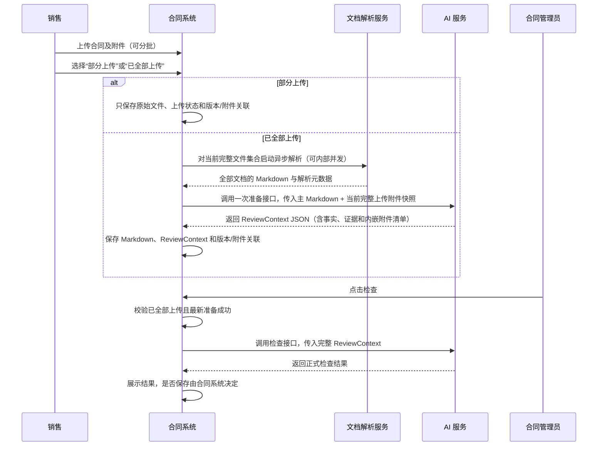

# 合同评审两阶段升级：合同系统协作沟通稿（草稿）

> 状态：未来升级沟通草稿，尚未立项、尚未实施，不代表当前接口已经变化。
>
> 更新日期：2026-08-10
>
> 权威来源：整体架构和责任边界以升级主文档为准；已立项能力的字段级契约以对应 OpenSpec 及正式 Schema 为准。本文只面向合同系统协作沟通，不单独维护字段或枚举。

## 1. 希望解决的问题

当前合同管理员点击检查后，AI 服务才开始处理合同全文、提取公共事实并执行全部检查，在线等待时间较长。拟利用“销售上传”和“合同管理员检查”之间的时间窗口，将材料准备提前完成。

本次讨论不要求合同系统实现 AI 检查逻辑，也不要求 AI 服务保存合同业务数据。

## 2. 拟议流程



## 3. 双方责任边界

| 事项 | 合同系统 | AI 服务 |
|---|---|---|
| 原始文件、Markdown 和业务记录持久化 | 主责 | 不落库 |
| 文档解析流程编排 | 销售标记“已全部上传”后，对当前完整文件集合启动解析；“部分上传”期间不为本评审链路触发解析 | 不负责解析原文件 |
| 正文内嵌附件识别后的索引和销售提示 | 保存、查询和展示 | 识别并返回清单 |
| 分批上传合并为当前完整快照 | 主责 | 接收完整快照 |
| 销售标记附件上传状态 | 提供“部分上传/已全部上传”选项，按合同版本保存，并控制解析、准备和正式检查入口 | 不根据附件数量推断销售是否还会补传 |
| 销售、合同管理员角色权限 | 主责 | 使用服务级鉴权，不替代业务权限 |
| 文档解析完成后调用准备接口 | 仅在“已全部上传”且当前完整文件集合全部解析成功后调用一次 | 提供准备接口 |
| ReviewContext 保存和版本关联 | 主责 | 生成 JSON，不保存 |
| 公共事实与候选证据提取 | 不实现 AI 逻辑 | 主责 |
| 正式检查触发 | 只允许合同管理员操作 | 被调用后执行 |
| 正式检查结果 | 接收和展示；是否保存自行决定 | 覆盖旧流程全部现有有效检查点，生成并返回 JSON |
| 本项目与第三方法务产品结果汇总 | 合同系统直接汇总，或由其选定的第三方产品汇总后提供给合同系统 | 只输出本项目自身规则包结果；不调用、接收或合并第三方结果 |
| 检查结果后的业务流转、拦截、确认和留痕 | 主责；按自身流程使用检查结果 | 不返回“允许继续”“禁止提交”或人工确认等流程指令 |
| 预设签署人主数据 | 按现有安全规则提供第二阶段按合同主体实时读取能力；负责接口鉴权和传输保护 | 只在本次 evaluate 请求的局部调用链中用于后端确定性比较，不进入 ReviewContext、模型、持久化、缓存、日志、Trace 或正式结果 |
| 上传侧附件重复控制 | 主责 | 单次准备请求兜底 |
| 跨请求或历史附件去重 | 主责 | 不负责 |

## 4. 合同系统需要提供的数据

销售选择“已全部上传”后，合同系统对当前完整文件集合启动文档解析；全部有效文档解析成功后，才调用准备接口。准备接口需要以下输入：

- `contract_id`：合同业务标识；
- `revision_id`：本次合同及附件快照版本；
- 主合同 `document_id`、文件名和 Markdown；
- `uploaded_attachments`：当前合同版本全部有效的销售上传附件，每个包含稳定的 `attachment_id`、文件名和 Markdown；
- 主合同和附件必须是完整快照，不是本次上传的增量。合同系统先合并历史有效附件与本次新增附件，再调用准备接口；例如 V1 为主合同+A+B，V2 应传主合同+A+B+C+D；
- 不要把此前由正文识别出的内嵌附件再次作为上传附件传入，本项目会从主 Markdown 重新识别；
- 如果解析接口已经返回稳定元数据，可选透传解析服务名称、版本和解析时间；
- 如果合同系统或对象存储已经生成原始文件 SHA-256，可选随对应文档传入，无需为了首期升级单独建设。

“解析器名称”是实际把 PDF、DOCX 等文件转换为 Markdown 的服务、产品或引擎标识，不是文件名、接口地址或合同系统名称。“解析器版本”应来自解析接口返回的服务发布号、引擎版本或稳定构建号；如果上游没有提供，字段省略，合同系统不需要自行编造。

原始文件 SHA-256 是对上传的 PDF、DOCX 等原始二进制文件计算的摘要，主要用于追溯和辅助重复识别。AI 服务还会对实际收到的 Markdown 自行计算 `parsed_content_sha256`，用于标识真正进入材料准备流程的文本。两者描述的对象不同，均不能替代业务身份字段 `attachment_id`。

`contract-review-context-foundation` OpenSpec 及本项目 `two_stage/schemas.py` 当前定义基础信封；准备接口的强类型事实和统一证据注册表骨架见升级主文档“5.1.1 已冻结的数据契约骨架”，实施以当前 `contract-review-prepare-api` OpenSpec 及正式 Schema 为准。合同系统应继续保存解析后的完整 Markdown（包括正文中的内嵌附件内容）作为权威来源；首期不要求另存一份去掉内嵌附件的正文 Markdown。

首期准备接口不要求合同系统判断“标准附件”，合同系统只需提供完整 Markdown 快照。AI 服务内部仅对可靠识别为需求说明书、技术规范书、工作说明书或质量标准的附件应用标准附件路径：仍完整保存清单、来源、摘要、声明关系和覆盖，并执行全文确定性安全扫描；无相关候选时不展开整份 LLM 提取，命中主体、签章、人员、签署日期、账户或公司级联系方式候选时只提取可定位局部范围。文件名不能单独触发该路径，补充协议、商务协议等目录外类型及类型/边界不可靠的附件继续普通完整提取。AI 服务不会运行时学习或自动扩充标准附件目录。

合同系统另行维护销售选择的附件上传状态，业务语义为：

- **部分上传**：销售仍可能继续补传附件。合同系统只保存原始文件、上传状态以及当前版本与附件的关联，不为合同评审链路调用文档解析服务或准备接口，也不开放正式检查入口；
- **已全部上传**：销售确认当前合同版本的材料已经提交完毕。合同系统对当前完整文件集合启动解析，可按文档并发执行；仅在全部有效文档解析成功并完成一次准备后，才允许合同管理员发起正式检查。

该状态是合同系统拥有的流程状态，不由文档解析服务或 AI 服务根据附件数量、正文附件声明或当前关联结果推断。首期准备接口不接收“部分上传”的中间快照；是否在第二阶段请求中透传“已全部上传”状态作为二次校验，由后续 `contract-review-evaluate-api` 字段契约确定。

上述闸门只约束合同评审两阶段链路。如果合同系统因文件预览、内容检索或其他独立业务能力需要提前解析，可以按该能力自身规则调用文档解析服务，但不得因此提前调用合同评审准备接口，也不得把非最终 Markdown 快照写入本评审链路的 `ReviewContext`。

## 5. 合同系统需要保存的数据

准备接口返回一份完整 `ReviewContext` JSON，主要包含：

- `schema_version`；
- `source_snapshot`：合同、附件和文档版本指纹；
- `shared_facts`：首部、主体、签章、金额付款、合同份数和附件声明/关联六类公共事实；
- `evidence_index.items[]`：统一证据注册表，每条证据具有唯一 `evidence_id`，各事实通过 `evidence_ids[]` 引用；
- `preparation_issues`：准备阶段发现的非正式检查问题；
- `preparation_meta`：生成版本和时间；
- `context_digest`：上下文内容摘要。
- 内嵌附件清单：稳定 `document_key`、`source_kind=EMBEDDED`、来源主文档、标题、位置和内容摘要，用于后续展示和重复预警。

其中 `pipeline_version` 位于 `preparation_meta`，由 AI 服务生成，代表事实提取、后处理和证据组装这一整套准备逻辑的版本。合同系统只需原样保存和回传，不负责生成或解释该版本。

合同系统建议为该 JSON 创建内部 `review_context_id`，并关联：

```text
contract_id + revision_id + review_context_id + schema_version + document_set_hash
```

`review_context_id` 是合同系统内部关联标识。管理员点击检查时，合同系统仍应将完整 `ReviewContext` JSON 传给 AI 服务，而不是要求 AI 服务按 ID 反向查询合同系统。

建议合同系统按以下逻辑能力设计存储，不预设具体表结构：合同版本、解析文档/Markdown、版本与上传附件关联、销售选择的附件上传状态、正文内嵌附件索引、ReviewContext，以及可选的正式检查结果记录。每个版本应能恢复完整有效附件快照，旧版本和旧上下文只用于历史审计。附件上传状态应与具体合同版本或文档集合绑定，不得作为脱离版本的合同全局状态复用。

## 6. 第二阶段调用方式

初始建议采用同步检查接口：

```text
POST /api/v1/contract-review/evaluate
```

合同系统传入：

- `review_context_id`；
- `contract_id`；
- `revision_id`；
- 第一阶段返回并保存的完整 `review_context`。

合同系统仅在销售已选择“已全部上传”、该版本全部有效文档解析完成且最新一次准备成功时调用正式检查接口。AI 服务完成 Schema、摘要和文档版本校验后执行正式检查。第二阶段覆盖旧流程全部现有有效检查点，不只包含 B-1/B-4；任何检查点未完成事实准备、判断实现和回归验证前，不切换生产调用。

首期 AI 服务内置一个默认规则包。每次调用 Evaluate，都会执行该规则包内的全部现有有效检查点，不由调用方指定只检查其中几个。未来可以增加服务、租赁、买卖、建设工程等合同类型专用规则包，但本期不要求合同系统建设规则管理，也不让 AI 服务猜测合同类型后静默切换。合同系统可以保存本次与历次返回结果并自行比较新增、消失或变化的问题，但不把历史检查结果回传给 AI 服务参与本次判断，也不把不同检查批次的局部结果拼成一份“本次全量检查结果”。

规则包的激活长期遵循同一兼容门槛：只有其依赖事实已经由生产版本 `ReviewContext` 稳定提供时才能启用；新增规则需要扩展事实域时，AI 服务应先完成 Prepare 数据契约扩展和 Prepare–Evaluate 兼容验证，再启用对应规则。合同管理员不需要理解或手工处理 Prepare 内部升级，AI 服务也不得把自身版本不兼容显示成合同未填写、解析覆盖不足或普通检查未完成。

合同正文和附件中的身份证号、银行账户及联系信息属于合同来源审核数据，可以作为事实和证据进入合同系统保存的完整 `ReviewContext`。系统预设中的签署人、身份证号、银行账户和联系信息采用更严格的运行时隔离：AI 服务在管理员触发 evaluate 后按当前合同主体实时读取，只在本次请求内由后端确定性比较，不传给模型，不保存或缓存，也不写入日志、Trace、指标标签和正式结果。正式结果不回显预设正确值。合同存在明确候选主体但预设零命中时，按合同主体与预设不一致返回对应检查点的硬阻断；已唯一命中预设档案但其中某个待校验字段为空时，也按对应检查点返回明确指向预设字段缺失的硬阻断，例如“签署地预设值中的【联系电话】没有设置，请联系系统管理员维护后重新审核”。预设服务超时、调用报错、返回异常，或者主体、预设档案、预设人员无法唯一定位时，只使依赖预设的检查点暂未完成审核；AI 服务仍返回不依赖预设的已完成检查结果，合同系统不得把这类响应当作整份合同审核完成。具体对外错误码由 `contract-review-evaluate-api` OpenSpec 定稿。

### 6.1 检查结果、部分检查结果与合同系统展示

AI 服务按“检查点 × 被检查对象”返回结果：主合同上的同一检查点是一条结果；同一检查点对不同上传或内嵌附件分别返回结果。同一检查点、同一对象上的多处问题统一放在这一条结果中，但每一处独立问题分别列出，不因原因类型相同而合并；不同检查点不得合并，合同系统可据此自行放置、筛选、保存或汇总结果。

每条正式结果包含稳定的语义 `check_key`、业务名称、固定对应的 `PASS/WARN/FAIL` 与“通过/提示/硬阻断”、每条原因的稳定 `reason_key` 和中文话术、被检查对象、以及合同原文证据引用。业务名称和中文话术用于展示；`check_key`、`reason_key` 用于合同系统长期对接，文案调整时不应改变其含义。旧 `SeqN`、`B-1`、`B-4` 等如合同系统需要兼容，可作为可选追溯信息返回，但不是新接口主键。AI 服务不返回页面布局指令；合同系统自行决定结果放置位置。

`check_key` 在本项目这一固定结果生产方内唯一，同一检查职责不因规则包版本更新而改变；`reason_key` 在所属 `check_key` 内唯一，同一原因不因文案、证据数量或严重程度变化而改变。合同系统可用 `check_key + reason_key` 识别原因类别，具体问题仍使用 `issue_key` 识别。

每次响应还会说明这批结果由本项目产生、实际使用的规则包及版本、执行引擎版本、检查时间，以及实际消费的合同文件快照和审核上下文，包括合同版本、文件集合摘要、上下文摘要及其 Schema/Prepare 流水线版本。规则包版本用于说明本次执行了哪组检查点，执行引擎版本用于说明由哪版程序和 Prompt 执行。这样无论合同系统直接接收，还是未来由第三方产品接收本项目结果后统一汇总，都能识别结果来源、适用范围和对应上下文；具体字段名由 Evaluate OpenSpec 定稿。

AI 服务不接收第三方法务产品的检查结果，也不负责内外部结果的映射、去重、优先级、失败回退或总结果计算。这些工作由合同系统自行完成，或者由合同系统选择的第三方产品完成。本项目以后因外部产品覆盖而减少某些检查点时，通过发布新的本项目规则包版本表达，不需要把第三方结果接入本项目。

`WARN/FAIL` 结果至少包含一处具体问题；每一处问题都包含在当前不可变合同文件快照内唯一、稳定的 `issue_key` 和自身等级，同一结果顶层等级取其中最严重的等级。问题身份以合同、合同版本、文件集合摘要与检查点、被检查对象、原因类型和业务发生位置或关系共同确定，不以每次 Prepare 都可能变化的上下文摘要为边界。同一文件快照重新 Prepare 后，只要这些业务坐标没有实质变化，文案、证据数量或顺序、上下文摘要以及单纯等级变化不改变该标记；业务坐标实质变化时生成新标记。`PASS`、“不适用”和“暂未完成审核”本身均不生成 `issue_key`。标记相同只说明是同一处具体问题，不代表历史人工放行自动继续有效；具体字段类型和生成算法由 Evaluate OpenSpec 定稿。

“通过”也不是只有一个顶层状态。AI 服务会把已经独立核验通过的业务事项逐条列出，每条保留原因标记、主体/字段/关系等业务坐标、业务说明和对应原文证据，但不生成 `issue_key`，也不依赖数组位置或证据顺序区分同类明细。因此，同一检查结果中可以同时看到已核验通过的事项、仍有问题的事项和不适用事项；顶层显示其中最严重的适用结论，但不会因此隐藏其他已经完成的核验。

字段缺失时，AI 服务返回实际检查过的原文范围或缺失要求证据，并明确缺失的主体、对象和字段位置，不伪造不存在的值证据；如果解析或定位覆盖不足，无法证明已经可靠检查完整范围，则只能说明“暂无法确认”，不能写成“没有填写”。

一个一致性问题涉及多个来源时只返回一次，挂在检查点预先定义的待校验对象下；比较基准只作为关联对象和证据。例如合同字段与预设比较时，合同字段是待校验对象；附件与主合同对应字段比较时，附件是待校验对象。附件不能脱离主合同直接用预设值证明自己正确：附件与主合同不同但恰好命中预设时，仍按附件—主合同不一致处理；附件与主合同相同但二者均与预设不一致时，附件一致性可以通过，但主合同自身的预设不一致结果仍独立保留。

每个检查点先判断是否适用。合同明确没有该检查对象或检查前提时，AI 服务仍返回一条“不适用”检查项及原因，例如“本合同没有附件，无需进行附件一致性检查”；检查点整体适用，但其中一个具有独立业务意义的可选事项因合同没有采用相应业务形式而不适用时，也明确返回一条“不适用明细”，不把内部判断条件或未采用的替代路径逐项展示给业务人员。合同系统应展示“不适用”，不得把它显示成“通过”，也不得因没有返回结果而无法区分“本来不该检查”和“结果遗漏”。“不适用”不是第四种正式审核结论：没有 `PASS/WARN/FAIL`，也没有 `issue_key`；保留原因标记和业务说明，但不计入“通过/提示/硬阻断”的汇总数量。

一个检查结果在不存在任何适用且必需的未完成事项时，只要还有适用且已经完成判断的事项，顶层就按这些适用事项中最严重的“通过/提示/硬阻断”展示，不适用明细只保留说明、不参与汇总；如果所有具有独立业务意义的事项都不适用，顶层才显示整个检查点“不适用”。如果是合同事实、证据或解析覆盖不足导致无法判断，不能让合同系统把它当成“不适用”。可定位到具体文档、事实类别和检查点的覆盖不足，应由相应检查点按已确认风险规则显示“提示”或“硬阻断”，并明确说明“暂无法确认”；只有预设服务错误等可局部化运行时依赖尚未完成时，才使用“暂未完成审核”。

同一检查点内如果有一项适用且必需的事项暂时无法完成，检查点顶层显示“暂未完成审核”，不显示顶层“通过/提示/硬阻断”。未完成原因需要明确受影响的主体、字段、关系或外部依赖，但不为未完成状态生成 `issue_key`。AI 服务仍保留这个检查点中已经完成事项的结论和证据，方便管理员了解已核验内容；但合同系统不得把这些明细计入整份合同结果数量，也不得据此把整份合同标记为检查完成。重新检查且全部适用事项都完成后，才形成该检查点的正式顶层结论。

所有正式结果（包括“通过”）均保留合同原文证据引用，合同系统可默认折叠展示。对于身份证号、银行账号等合同侧敏感信息，继续按展示规则脱敏；预设侧正确值始终不返回。

兼容性预检通过并进入审核结果后，合同系统按本次调用区分以下三种呈现，不把“暂未完成审核”当作第四种检查结论：

- **全部检查完成**：本项目本次规则包内全部适用检查点已有“通过/提示/硬阻断”，不适用检查点已明确显示“不适用”；这只表示本项目规则包已经完成，不代表合同系统或第三方产品已完成企业级总结果汇总。汇总方不把不适用项目计入三档结果数量。
- **部分检查结果**：展示不受可局部化运行时依赖影响的正式结果；受预设服务错误、预设无法唯一定位等依赖影响的检查点单列“暂未完成审核”，可以展示其中已完成明细，但不把这些明细计入整份合同结果数量，也不对整份合同生成总结果。
- **本次审核未完成**：合同版本、上下文完整性等前置校验失败，或发生无法安全局部化的服务错误时，不展示任何正式检查结果。合同内容更新时提示“当前合同内容已更新，请重新发起审核”；无法定位具体原因的暂时性服务问题提示“本次审核未完成，请稍后重新审核；如仍无法完成，请联系系统管理员”。

“需要刷新审核上下文”是发生在上述三种审核结果之前、与它们互斥的控制响应，不是第四种检查等级，也不是普通“本次审核未完成”。收到该信号时本次响应没有正式结果、检查点、明细、问题、证据或结果数量；合同系统自动使用同一文件快照重新 Prepare 并重试后，下一次 Evaluate 才进入上述三种呈现之一。

合同系统统计时需要分别保存规则包内不同检查点数量、按主合同或附件动态展开后的结果项数量、具体问题数量，以及只针对已完成顶层结果统计的“通过/提示/硬阻断”数量。不得用问题数量代替结果项数量，也不得把“不适用”、暂未完成结果或暂未完成结果中的已完成明细计入三档汇总。

合同字段已经可靠取得但缺失、留空、无效或冲突时，按相应检查点的规则显示“提示”或“硬阻断”，原因明确写合同需要补充或修订。因合同文件解析、版面或证据定位问题无法可靠确认时，不得写成“合同未填写”；应按检查点规则显示“提示”或“硬阻断”，并说明“暂无法确认……，请核对合同文件后重新审核”。

付款阶段的金额书写核验和数字算术核验在两阶段结果中分开归属。序号7检查主合同内所有适用金额对象的数字金额与中文大写，包括付款阶段金额；序号10只使用付款阶段数字金额、比例和有证据的合同整体金额关系检查比例合计及金额算术关系，不读取大写金额形成序号10问题。阶段数字金额与“合同整体金额 × 阶段比例”的精确计算结果存在任何非零差额时，序号10显示“硬阻断”；AI 服务不设置舍入容差，不选择某一阶段吸收尾差，也不调整合同金额或比例。计算结果和差额可以作为裁决说明，但不是合同原文证据。合同系统如允许管理员处理该问题，应将人工决定叠加在原始 `FAIL` 之外，不把 AI 原始结果改为 `PASS`。

序号 1 的首页事实由 AI 服务从主合同首部提取。合同名称缺失、留空或只有“合同”“服务合同”等泛化标题，而项目名称具有可靠、唯一的实际识别意义时，第二阶段整体使用项目名称和项目编号；合同编号不能单独强制选择合同身份组，两组字段不得交叉拼接。主合同首页我方公司名称必须与预设主体完整法定名称完全一致。签订地点允许包含省份、区县或详细地址，只要能够从该栏位实际值中可靠且唯一地提取出城市；合同系统无需另外提供一个独立的城市一致性检查结果。

正式签章检查只关注客户侧和我方侧，第三方至第 N 方只保留必要事实以避免错误归属，不生成正式检查问题。附件签章块中的客户侧和我方侧公司名称、法定代表人、授权人均为非必查项：没有栏位或没有实际填写时不校验、不提示；实际填写后才与主合同同一侧、同一角色内容比较，不一致时返回 `FAIL`。客户侧只检查主合同公司名称存在、主合同签章块签署人姓名是否填写，以及附件实填姓名与主合同一致，不读取客户侧人员预设，也不检查客户侧身份证号、日期、账户、联系方式、印章或签字；我方侧继续执行预设、账户、联系信息以及“有签署人姓名且填写身份证号时才比较身份证号”的规则。因解析或版面损坏而无法可靠看清附件是否存在或填写了待核验签署栏位，不等于“没有填写”，仍由正式检查提示管理员查看原文。

是否改成后台异步检查，不作为本次架构的前置条件。新链路上线试点后，根据实际 P95 时延和超时情况共同决定。

## 7. 文档版本与重新准备

`ReviewContext` 对应一次不可变的合同及附件快照。

合同正文或任何附件修改后：

1. 合同系统生成新的 `revision_id`；
2. 将新版本恢复为“部分上传”，旧的完成确认、`ReviewContext` 和正式检查结果立即失效；
3. “部分上传”期间只保存原始文件和版本/附件关联，不为本评审链路调用解析或准备接口；
4. 销售重新选择“已全部上传”后，解析当前完整文件集合；全部解析成功后调用一次准备接口并保存新的 `ReviewContext`；
5. 旧上下文可保留用于历史审计，但不得默认用于新版本检查。

如果检查请求中的 `revision_id` 与上下文不一致，AI 服务拒绝检查并提示重新准备。

销售分批上传时，合同系统持续合并此前仍有效的上传附件与本批新增附件，但不在每一批后调用文档解析服务或准备接口。销售选择“已全部上传”后，合同系统对当时的完整有效文件集合启动解析；全部解析成功后，在当前 Prepare 数据契约和流水线版本下调用一次准备接口。未来版本兼容刷新仍按第 13 节使用同一文件快照重新 Prepare。若此前已生成内嵌附件索引，合同系统仍可据此在后续版本上传疑似重复文件时提前提示；AI 准备阶段会从最终主 Markdown 重新识别并做请求级重复校验。

建议新合同版本默认处于“部分上传”。销售选择“已全部上传”后，如果正文或附件发生新增、删除或替换，合同系统应将新版本自动恢复为“部分上传”，使旧的完成确认、`ReviewContext` 和正式检查结果失效；销售需要针对最新文件集合重新确认“已全部上传”。如果合同本身不需要附件，销售仍可在仅有正文的情况下选择“已全部上传”。

解析失败后的自动重试不改变销售已经确认的上传状态。同一原始文件集合重新解析时，也不要求销售再次确认“已全部上传”；但如果重新生成的 Markdown 或解析元数据发生变化，合同系统应使旧 `ReviewContext` 和正式检查结果失效，并在当前完整文件集合全部解析成功后重新调用一次准备接口。

准备阶段只接收销售已经确认“已全部上传”的最新完整快照，并保存正文中的附件声明、当前实际文档来源及中性关联事实，不输出“缺少附件”或“多余附件”等正式判断。管理员基于该最新快照发起第二阶段后，才判断附件缺失、额外或标题不一致。

## 8. 附件重复控制

本节继承任务 `019fa823-e456-7873-ab7a-6ac0a8347067`（评估附件重复控制）的结论。

### 8.1 合同系统主控制

合同系统负责：

- 上传按钮防重复提交；
- 请求幂等；
- 附件记录唯一性；
- 同一 `attachment_id` 不得在同一合同版本中重复关联；
- 跨请求、跨上传会话和历史版本的重复控制；
- 对疑似重复附件提供人工确认入口。
- 依据已保存的内嵌附件索引，在销售再次上传疑似重复文件时提示其来源；不能仅凭文件名或仅凭内容哈希静默合并。

### 8.2 AI 服务兜底

准备接口在任何模型调用前执行单次请求校验：

- `attachment_id` 重复：拒绝请求；
- 不同 `attachment_id` 的上传附件，其规范化原始文件名和 Markdown 内容哈希均相同：拒绝请求；
- 正文内嵌附件与上传附件的规范化标题和内容哈希均相同：在附件计数和 AI 检查前拒绝；
- 仅文件名相同或仅内容相同：不自动删除，保留并在 `preparation_issues` 中提示疑似重复。

这里的“Markdown 内容哈希”由 AI 服务对实际收到的 Markdown 做固定规范化后计算 SHA-256。哈希相同表示规范化文本相同，不代表两个附件在业务上必然是同一份，因此只有内容相同仍按疑似重复处理。

明确重复附件不会被静默去重后继续检查，因为这会掩盖上游数据问题并改变合同材料集合。

## 9. 异常处理建议

| 场景 | AI 服务行为 | 合同系统建议行为 |
|---|---|---|
| 明确重复附件 | 准备失败，不调用模型 | 返回上传或材料列表让用户修正 |
| 第一阶段暂时失败 | 返回明确错误 | 后台重试，并保留失败原因 |
| 销售选择“部分上传” | 文档解析服务和 AI 准备接口均不被本评审链路调用 | 只保存原始文件、上传状态和版本/附件关联 |
| 已标记“已全部上传”，但仍有文档解析中或最新准备失败 | 不进入正式检查 | 保持检查入口不可用，等待解析/重试成功 |
| `ReviewContext` 结构真实、完整且合同版本匹配，但不满足最新规则包事实兼容要求 | 返回“需要刷新审核上下文”控制信号，不产生正式结果 | 使用同一文件快照自动重新准备并重试，不要求用户重新上传 |
| `ReviewContext` 无法按声明 Schema 安全解析或验证 | 请求失败，不执行正式检查 | 检查保存、传输或版本支持问题，不伪装成自动刷新 |
| 上下文摘要不一致 | 拒绝正式检查 | 检查保存/传输过程，不自动忽略 |
| 合同版本不一致 | 拒绝正式检查 | 切换到最新上下文或重新准备 |
| 某事实域或文档覆盖为 `PARTIAL/UNAVAILABLE` | 按受影响检查点已确认的覆盖不足规则返回“提示”或“硬阻断”，说明“暂无法确认” | 展示原始检查结果和覆盖原因，不当作“不适用”或普通“暂未完成审核” |

事实域状态值以 `contract-review-context-foundation` OpenSpec 和 `two_stage/schemas.py` 定义的 `COMPLETE/PARTIAL/UNAVAILABLE` 为唯一来源，沟通稿不另行维护其他枚举值。

## 10. 联调与验收建议

- 同一合同版本的 Markdown、附件列表和 `ReviewContext` 可以稳定关联。
- 合同修改后能够生成新版本上下文，旧上下文不会误用于最新检查。
- 合同系统保存的 JSON 可以原样传回，不由前端重新拼装。
- 同一 `attachment_id` 重复时，合同系统优先阻止；绕过后 AI 服务仍能在模型调用前拒绝。
- 仅同名或仅同内容的合法不同附件不会被静默删除。
- 管理员点击前不生成正式检查结论。
- “部分上传”期间，本评审链路调用文档解析服务和准备接口的次数均为 0，也不能发起正式检查。
- 销售选择“已全部上传”后，对当前完整文件集合完成解析，并在当前 Prepare 版本下调用一次准备接口生成该版本的 `ReviewContext`；未来 Prepare 数据契约升级时，适用第 13 节的同一文件快照自动刷新建议。
- “已全部上传”只对当前合同版本或文档集合有效；材料变化后自动恢复为“部分上传”，旧上下文和旧检查结果不会继续使用。
- 不需要附件的合同可以在仅有正文时选择“已全部上传”，不会因附件列表为空而导致准备失败。
- 销售无权触发正式检查。
- 旧流程全部现有有效检查点均有新架构实现和新旧结果对比，B-1/B-4 不作为范围上限。
- 付款阶段数字/大写书写问题只归序号7；付款阶段数字金额、比例和合同整体金额的算术问题只归序号10，同一事实可以复用但不得重复裁决。
- 阶段金额存在任何非零算术差额时仍为硬阻断，不设置舍入容差或自动尾差调整。
- 新旧检查链路在试点合同上的最终结论可对比、可追溯。
- 记录准备阶段耗时、检查阶段 P50/P95 耗时和模型调用次数，再决定第二阶段是否异步化。

## 11. 需要合同系统同学确认

- 是否能为每个上传附件提供稳定且不可复用的 `attachment_id`。
- 当前文档解析接口是否返回解析服务名称、发布版本或引擎版本；如不返回，首期不要求补造。
- 是否已经生成原始文件 SHA-256；如未生成，首期可以不提供，不作为接口阻塞项。
- 合同及附件修改时，当前是否已有统一 `revision_id` 机制。
- 可以保存的 `ReviewContext` 单条 JSON 最大体积和保存期限。
- 文档解析失败或 AI 准备失败目前采用什么重试和状态展示机制。
- “部分上传/已全部上传”的前端文案、默认值，以及正文或附件变化后自动恢复为“部分上传”的交互提示。
- 管理员点击检查时，前端可接受的同步等待目标是多少。
- 第二阶段按合同主体实时读取签署人预设主数据的接口、权限和传输保护方式；合同来源审核数据进入完整 `ReviewContext`，预设主数据只在 evaluate 请求内使用且不进入模型、持久化、日志、Trace 或正式结果；首期不引入 HMAC 或专用令牌。

“附件金额与合同正文金额一致性”已确认不纳入当前两阶段首期，不作为本节待确认项。未来如需扩围，应重新提醒并单独确认金额口径、适用附件类型和结果等级。

## 12. 合同系统人工放行与版本继承建议

本节仅作为合同系统后续产品和流程设计的参考，不是 AI 检查接口要求。合同系统如何保存人工放行、合同升级后是否允许沿用、由谁确认以及如何影响最终流转，均由合同系统结合自身权限、审计和风险规则决定。

无论合同系统采用何种放行策略，AI 服务都只针对当前合同版本正常执行检查并返回原始结果，不接收历史放行记录或“继续有效”选择，不因人工放行跳过检查，也不把原始 `WARN/FAIL` 改为 `PASS`。合同系统应将 AI 原始检查结果与管理员处理结果分层保存和展示，避免人工处理覆盖原始判断及证据。

合同正文或附件形成新版本后，旧 `ReviewContext` 和旧正式检查结果不得作为新版本结果继续使用；历史放行记录是否可以关联到新版本，是另一项独立的合同系统业务决策。合同系统可以根据业务风险选择“新版本全部重新确认”“仅允许明确对应的具体问题继续有效”或“由管理员在新检查后逐条确认是否沿用”等策略。若允许沿用，建议至少保留原放行记录、新旧合同版本、对应检查点、被检查对象、具体原因、原始证据、确认人员和确认时间，且不得把一次放行扩大为整个检查点或新出现问题的放行。

同一不可变合同文件快照重复检查或自动重新 Prepare 时，只要合同、合同版本、文件集合摘要、检查点、被检查对象、原因类型和业务发生位置或关系没有实质变化，合同系统可使用 AI 结果中的 `issue_key` 识别同一处具体问题；上下文摘要变化本身不切断该身份。合同升级或文件集合摘要变化后，Evaluate 不接收上一文件快照结果，不返回 `previous_issue_key`、`supersedes_issue_key` 等历史关系，也不承诺 `issue_key` 可以单独证明跨文件快照继承；合同系统如需辅助关联新旧问题，可结合检查点、被检查对象、原因类型、业务发生位置和证据形成候选并由自身流程确认。无论问题标记是否相同、历史放行是否沿用，合同系统的最终处理都不回传给 Evaluate 参与裁决，Evaluate 再次检查仍返回当前事实和规则下的原始结论。

## 13. 规则升级后的审核上下文刷新建议

本节是合同系统或未来第三方调用方的编排建议，不要求用户重新上传，也不改变本项目无状态、Evaluate 不补做 Prepare 的边界。具体触发时机、自动重试、历史保存和页面提示由调用方结合自身流程决定。

当已激活规则包需要新版 Prepare 才能稳定提供的事实时，调用方可使用已经保存的当前主合同及全部附件 Markdown，针对完全相同的文件快照重新调用 Prepare。`contract_id`、`revision_id`、文档业务标识、文件摘要和 `document_set_hash` 保持不变，不把这次重建解释为合同升级，也不要求销售重新确认“已全部上传”；新生成的 `ReviewContext` 使用新的 `review_context_id`、准备版本和 `context_digest`，作为后续 Evaluate 的当前上下文。同一具体问题的业务坐标未变时，新的上下文摘要不改变其 `issue_key`，但也不自动延续人工放行。

旧 `ReviewContext` 和旧规则包检查结果建议继续保留用于历史审计，不原地覆盖，也不与新上下文结果混用。调用方可以在规则启用前主动批量刷新，也可以在 Evaluate 返回“需要刷新审核上下文”的机器信号后自动执行“重新 Prepare—保存新上下文—重试 Evaluate”；无论采用哪种方式，合同管理员不应看到 Schema、事实域或 Prepare 版本等内部术语。若自动刷新失败，应按系统处理失败提示，不得显示为合同未填写、解析覆盖不足或普通检查未完成。

“需要刷新审核上下文”首先是供调用接口识别和自动编排的控制信号，不是直接展示给合同管理员的检查结果。该响应不包含 `PASS/WARN/FAIL`，也不生成 `check_key`、`reason_key`、`issue_key`、合同证据或结果数量；但需要能够关联当前合同文件快照、当前审核上下文及目标规则包版本，供调用方安全地重新 Prepare 和重试。自动刷新成功时，管理员无需感知，继续取得正常检查结果；刷新仍在进行时，调用方可以提示“正在按最新审核规则更新审核材料”；刷新失败时，可以提示“审核材料更新未完成，请稍后重新检查；如仍未完成，请联系系统管理员”。摘要被篡改、合同版本不一致或上下文无法安全解析属于请求失败，不得伪装成刷新信号。具体机器码、兼容版本字段和重试协议由后续 Evaluate 接口契约确认。

同一合同版本再次检查时，AI 服务始终以当时已经激活的最新规则包为目标，不接受调用方指定或回退到历史规则包。当前 `ReviewContext` 兼容时直接检查；不兼容时，调用方按上述机制自动刷新上下文后重试。历史规则包版本、旧上下文和旧检查结果继续保留用于比较和审计，但不回传给 AI 服务参与当前裁决。

## 14. 草稿维护约定

当前框架仍会继续测试和修复。后续测试、样本或联调发现的新问题，如果揭示了通用数据缺口、责任边界或接口约束，应先更新升级主文档，再同步更新本文相关摘要。

单一公司名、单一合同措辞或单一附件标题不会直接升级为跨系统规则。
