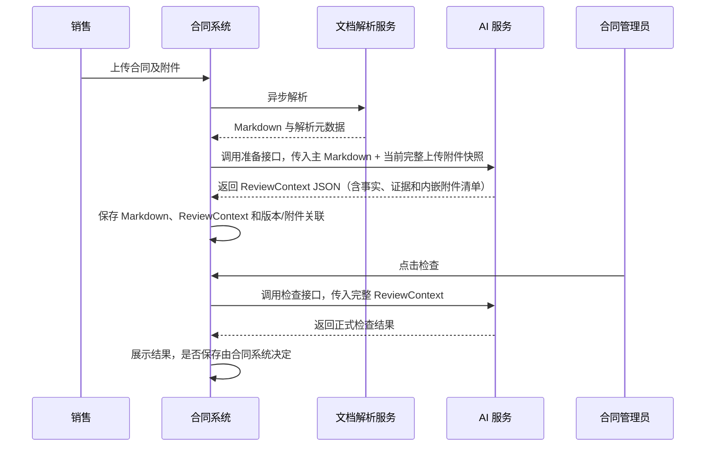

# 合同评审两阶段升级：合同系统协作沟通稿（草稿）

> 状态：未来升级沟通草稿，尚未立项、尚未实施，不代表当前接口已经变化。
>
> 更新日期：2026-07-31
>
> 权威来源：详细架构、字段和约束以 `docs/superpowers/specs/2026-07-28-contract-review-two-stage-upgrade-draft.md` 为准；本文只面向合同系统协作沟通，不单独维护字段枚举。

## 1. 希望解决的问题

当前合同管理员点击检查后，AI 服务才开始处理合同全文、提取公共事实并执行全部检查，在线等待时间较长。拟利用“销售上传”和“合同管理员检查”之间的时间窗口，将材料准备提前完成。

本次讨论不要求合同系统实现 AI 检查逻辑，也不要求 AI 服务保存合同业务数据。

## 2. 拟议流程



## 3. 双方责任边界

| 事项 | 合同系统 | AI 服务 |
|---|---|---|
| 原始文件、Markdown 和业务记录持久化 | 主责 | 不落库 |
| 文档解析流程编排 | 主责 | 不负责解析原文件 |
| 正文内嵌附件识别后的索引和销售提示 | 保存、查询和展示 | 识别并返回清单 |
| 分批上传合并为当前完整快照 | 主责 | 接收完整快照 |
| 销售、合同管理员角色权限 | 主责 | 使用服务级鉴权，不替代业务权限 |
| 文档解析完成后调用准备接口 | 主责 | 提供准备接口 |
| ReviewContext 保存和版本关联 | 主责 | 生成 JSON，不保存 |
| 公共事实与候选证据提取 | 不实现 AI 逻辑 | 主责 |
| 正式检查触发 | 只允许合同管理员操作 | 被调用后执行 |
| 正式检查结果 | 接收和展示；是否保存自行决定 | 覆盖旧流程全部现有有效检查点，生成并返回 JSON |
| 预设签署人主数据 | 按现有规则提供第二阶段实时读取能力 | 只在本次检查内使用，不保存、不回传 |
| 上传侧附件重复控制 | 主责 | 单次准备请求兜底 |
| 跨请求或历史附件去重 | 主责 | 不负责 |

## 4. 合同系统需要提供的数据

准备接口需要以下输入：

- `contract_id`：合同业务标识；
- `revision_id`：本次合同及附件快照版本；
- 主合同 `document_id`、文件名和 Markdown；
- `uploaded_attachments`：当前合同版本全部有效的销售上传附件，每个包含稳定的 `attachment_id`、文件名和 Markdown；
- 主合同和附件必须是完整快照，不是本次上传的增量。合同系统先合并历史有效附件与本次新增附件，再调用准备接口；例如 V1 为主合同+A+B，V2 应传主合同+A+B+C+D；
- 不要把此前由正文识别出的内嵌附件再次作为上传附件传入，本项目会从主 Markdown 重新识别；
- 如果解析接口已经返回稳定元数据，可选透传解析服务名称、版本和解析时间；
- 如果合同系统或对象存储已经生成原始文件 SHA-256，可选随对应文档传入，无需为了首期升级单独建设。

“解析器名称”是实际把 PDF、DOCX 等文件转换为 Markdown 的服务、产品或引擎标识，不是文件名、接口地址或合同系统名称。“解析器版本”应来自解析接口返回的服务发布号、引擎版本或稳定构建号；如果上游没有提供，字段省略，合同系统不需要自行编造。

原始文件 SHA-256 是对上传的 PDF、DOCX 等原始二进制文件计算的摘要，主要用于追溯和辅助重复识别。AI 服务还会对实际收到的 Markdown 自行计算 `parsed_content_sha256`，用于标识真正进入材料准备流程的文本。两者描述的对象不同，均不能替代业务身份字段 `attachment_id`。

字段结构以升级主文档“5.1 第一阶段：准备接口”为准。合同系统应继续保存解析后的完整 Markdown（包括正文中的内嵌附件内容）作为权威来源；首期不要求另存一份去掉内嵌附件的正文 Markdown。

## 5. 合同系统需要保存的数据

准备接口返回一份完整 `ReviewContext` JSON，主要包含：

- `schema_version`；
- `source_snapshot`：合同、附件和文档版本指纹；
- `shared_facts`：主体、签章、金额、付款、附件声明等公共事实；
- `evidence_index`：候选称谓、金额、签章和附件关系证据；
- `preparation_issues`：准备阶段发现的非正式检查问题；
- `preparation_meta`：生成版本和时间；
- `context_digest`：上下文内容摘要。
- 内嵌附件清单：稳定 `document_key`、`source_kind=EMBEDDED`、来源主文档、标题、位置和内容摘要，用于后续展示和重复预警。

其中 `pipeline_version` 位于 `preparation_meta`，由 AI 服务生成，代表事实提取、后处理和证据组装这一整套准备逻辑的版本。合同系统只需原样保存和回传，不负责生成或解释该版本。

合同系统建议为该 JSON 创建内部 `review_context_id`，并关联：

```text
contract_id + revision_id + review_context_id + schema_version + document_set_hash
```

`review_context_id` 是合同系统内部关联标识。管理员点击检查时，合同系统仍应将完整 `ReviewContext` JSON 传给 AI 服务，而不是要求 AI 服务按 ID 反向查询合同系统。

建议合同系统按以下逻辑能力设计存储，不预设具体表结构：合同版本、解析文档/Markdown、版本与上传附件关联、正文内嵌附件索引、ReviewContext，以及可选的正式检查结果记录。每个版本应能恢复完整有效附件快照，旧版本和旧上下文只用于历史审计。

## 6. 第二阶段调用方式

初始建议采用同步检查接口：

```text
POST /api/v1/contract-review/evaluate
```

合同系统传入：

- `review_context_id`；
- `contract_id`；
- `revision_id`；
- 第一阶段返回并保存的完整 `review_context`。

AI 服务完成 Schema、摘要和文档版本校验后执行正式检查，沿用现有检查结果结构返回。第二阶段覆盖旧流程全部现有有效检查点，不只包含 B-1/B-4；任何检查点未完成事实准备、判断实现和回归验证前，不切换生产调用。

是否改成后台异步检查，不作为本次架构的前置条件。新链路上线试点后，根据实际 P95 时延和超时情况共同决定。

## 7. 文档版本与重新准备

`ReviewContext` 对应一次不可变的合同及附件快照。

合同正文或任何附件修改后：

1. 合同系统生成新的 `revision_id`；
2. 重新调用准备接口；
3. 保存新的 `ReviewContext`；
4. 旧上下文保留用于历史审计，但不得默认用于新版本检查。

如果检查请求中的 `revision_id` 与上下文不一致，AI 服务拒绝检查并提示重新准备。

销售分批上传时，每一批形成新的合同版本快照；合同系统负责把此前仍有效的上传附件与本批新增附件合并后再调用准备接口。若正文拆出的内嵌附件后来又被销售上传，合同系统可依据已保存的内嵌附件索引提前提示，AI 准备阶段仍会从正文重新识别并做最终重复校验。

## 8. 附件重复控制

本节继承任务 `019fa823-e456-7873-ab7a-6ac0a8347067`（评估附件重复控制）的结论。

### 8.1 合同系统主控制

合同系统负责：

- 上传按钮防重复提交；
- 请求幂等；
- 附件记录唯一性；
- 同一 `attachment_id` 不得在同一合同版本中重复关联；
- 跨请求、跨上传会话和历史版本的重复控制；
- 对疑似重复附件提供人工确认入口。
- 依据已保存的内嵌附件索引，在销售再次上传疑似重复文件时提示其来源；不能仅凭文件名或仅凭内容哈希静默合并。

### 8.2 AI 服务兜底

准备接口在任何模型调用前执行单次请求校验：

- `attachment_id` 重复：拒绝请求；
- 缺少身份字段且“规范化文件名 + Markdown 内容哈希”均相同：拒绝请求；
- 正文内嵌附件与上传附件的规范化标题和内容哈希均相同：在附件计数和 AI 检查前拒绝；
- 仅文件名相同或仅内容相同：不自动删除，保留并在 `preparation_issues` 中提示疑似重复。

这里的“Markdown 内容哈希”由 AI 服务对实际收到的 Markdown 做固定规范化后计算 SHA-256。哈希相同表示规范化文本相同，不代表两个附件在业务上必然是同一份，因此只有内容相同仍按疑似重复处理。

明确重复附件不会被静默去重后继续检查，因为这会掩盖上游数据问题并改变合同材料集合。

## 9. 异常处理建议

| 场景 | AI 服务行为 | 合同系统建议行为 |
|---|---|---|
| 明确重复附件 | 准备失败，不调用模型 | 返回上传或材料列表让用户修正 |
| 第一阶段暂时失败 | 返回明确错误 | 后台重试，并保留失败原因 |
| `ReviewContext` 版本过旧 | 拒绝正式检查 | 使用当前文档版本重新准备 |
| 上下文摘要不一致 | 拒绝正式检查 | 检查保存/传输过程，不自动忽略 |
| 合同版本不一致 | 拒绝正式检查 | 切换到最新上下文或重新准备 |
| 某事实域为 `PARTIAL/UNAVAILABLE` | 不静默判定为通过 | 展示相应检查无法完成或需要确认 |

事实域状态值以升级主文档定义的 `COMPLETE/PARTIAL/UNAVAILABLE` 为唯一来源。

## 10. 联调与验收建议

- 同一合同版本的 Markdown、附件列表和 `ReviewContext` 可以稳定关联。
- 合同修改后能够生成新版本上下文，旧上下文不会误用于最新检查。
- 合同系统保存的 JSON 可以原样传回，不由前端重新拼装。
- 同一 `attachment_id` 重复时，合同系统优先阻止；绕过后 AI 服务仍能在模型调用前拒绝。
- 仅同名或仅同内容的合法不同附件不会被静默删除。
- 管理员点击前不生成正式检查结论。
- 销售无权触发正式检查。
- 旧流程全部现有有效检查点均有新架构实现和新旧结果对比，B-1/B-4 不作为范围上限。
- 新旧检查链路在试点合同上的最终结论可对比、可追溯。
- 记录准备阶段耗时、检查阶段 P50/P95 耗时和模型调用次数，再决定第二阶段是否异步化。

## 11. 需要合同系统同学确认

- 是否能为每个上传附件提供稳定且不可复用的 `attachment_id`。
- 当前文档解析接口是否返回解析服务名称、发布版本或引擎版本；如不返回，首期不要求补造。
- 是否已经生成原始文件 SHA-256；如未生成，首期可以不提供，不作为接口阻塞项。
- 合同及附件修改时，当前是否已有统一 `revision_id` 机制。
- 可以保存的 `ReviewContext` 单条 JSON 最大体积和保存期限。
- 文档解析失败或 AI 准备失败目前采用什么重试和状态展示机制。
- 管理员点击检查时，前端可接受的同步等待目标是多少。
- 第二阶段实时读取签署人预设主数据的接口、权限和传输保护方式；合同正文和附件中的身份证号按审核内容处理，不在本项目首期引入 HMAC 或专用令牌。
- 是否需要“附件金额与合同正文金额一致性”候选检查，以及金额口径、适用附件类型和 WARN/FAIL 规则。

## 12. 草稿维护约定

当前框架仍会继续测试和修复。后续测试、样本或联调发现的新问题，如果揭示了通用数据缺口、责任边界或接口约束，应先更新升级主文档，再同步更新本文相关摘要。

单一公司名、单一合同措辞或单一附件标题不会直接升级为跨系统规则。
