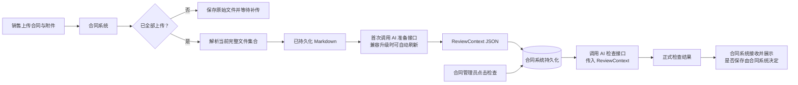

# 合同评审两阶段架构升级方案（草稿）

> 状态：未来升级方案草稿，尚未立项、尚未实施，不代表当前生产行为。
>
> 更新日期：2026-08-15
>
> 文档权威关系：当前生产行为仍以现有代码、已生效 OpenSpec 和接口契约为准。本草稿负责未来升级的整体架构、责任边界和后续接口方向；已立项能力的字段级契约以对应 OpenSpec 及正式 Schema 为准。`docs/integration/2026-07-28-contract-system-two-stage-review-communication-draft.md` 仅为对外沟通摘要，不作为字段定义来源。
>
> 字段中英文对照：`docs/superpowers/specs/2026-08-03-contract-review-two-stage-field-glossary.md`。该对照表只辅助理解，不替代本草稿、OpenSpec 或正式 Schema。

## 1. 背景

当前合同评审接口在一次同步请求中完成 Markdown 预处理、公共事实提取、附件识别、检查点执行和结果汇总。该方式实现简单、无状态，但存在以下问题：

- 合同管理员点击检查后，需要在线等待全部模型调用完成。
- 多个检查点重复消费合同全文或附件全文。
- 公共事实提取、附件处理、检查判断和结果渲染集中在同一条流水线，职责边界不够清晰。
- 单个步骤失败会影响整次检查，难以从中间状态恢复。
- 合同解析、材料准备和正式检查由不同角色或不同时间触发，但当前接口没有表达这一业务过程。

合同系统现状和已确认业务边界如下：

- 销售可以在合同系统分批上传合同及附件，并为当前文件集合选择“部分上传”或“已全部上传”。
- “部分上传”期间，合同系统只保存原始文件、上传状态和版本/附件关联，不为合同评审链路调用文档解析服务或材料准备接口。
- 销售选择“已全部上传”后，合同系统对当前完整文件集合启动文档解析；全部有效文档解析成功后，首次自动调用本项目的材料准备接口。后续若 Prepare 数据契约或流水线升级，可对同一文件快照自动重新准备，不要求用户重新上传。
- 第一阶段仍由本项目提供 AI 能力，但只返回 JSON；JSON 由合同系统持久化，本项目不落库。
- 正式检查必须由合同管理员点击触发，不能在销售上传后自动生成正式检查结论。
- 第二阶段初始设计为同步检查接口；是否异步化须依据升级后实测 P95 时延决定。

## 2. 目标与非目标

### 2.1 目标

- 将自动材料准备与人工触发的正式检查分离。
- 让本项目继续保持无状态 AI 能力服务，不新增业务数据库作为本次升级的默认前提。
- 公共事实和候选证据在一个不可变 `ReviewContext` 内只准备一次并供后续检查复用；只有文件快照变化，或 Prepare 数据契约、流水线升级触发兼容刷新时才重新准备。
- 第一阶段产出版本化、可校验、可追溯的 `ReviewContext` JSON。
- 第二阶段只消费 `ReviewContext`，执行确定性规则和必要的定向语义判断。
- 保留当前检查结果契约的兼容迁移路径。
- 将附件重复控制落实为“合同系统主控制 + AI 服务单次请求兜底”。

### 2.2 非目标

- 本项目不负责原始文件上传、持久化和跨请求附件历史去重。
- 本项目不负责销售与合同管理员的角色授权；该权限由合同系统控制。
- 第一阶段不输出正式 `PASS/WARN/FAIL` 检查结论。
- 不按 `B-1_input`、`B-4_input` 等检查点编号组织中间数据。
- 不在本次草稿中承诺第二阶段一定采用异步任务。
- 不因个别合同样例增加文件名、称谓或附件标题黑名单。

## 3. 架构决策

### 3.1 两阶段、两个责任面



第一阶段是“准备面”：在销售确认当前版本已经全部上传、全部有效文档解析成功后首次自动执行事实提取、材料规范化和候选证据索引，但不作正式业务裁决；同一文件快照后续只在 Prepare 兼容升级需要时自动重新准备。

第二阶段是“决策面”：由合同管理员触发，读取固定版本的 `ReviewContext`，输出正式检查结果。

2026-08-09 确认模型与程序的职责边界：业务规则确认项不与程序分支一一对应。LLM 负责高召回语义识别和关系提取，包括识别非固定版式中的事实区域、主体与人员角色、字段用途、附件本地定义、人员—号码关联及其不确定性，并按强类型输出契约返回候选事实、状态和证据；第一阶段不得由 LLM 直接输出正式 `PASS/WARN/FAIL`。后端确定性程序负责 Schema 和证据验证、可靠的格式规范化、运行时预设查询与隔离、姓名/身份证号/账户/联系值等值比较、日期比较、覆盖聚合、错误语义以及正式结果裁决。

语义证据不足时，LLM 必须显式返回 `UNCERTAIN` 或相应覆盖缺口，程序再按已确认规则稳定映射为 `WARN`、`FAIL` 或接口错误；不得让模型以综合判断自由选择正式等级，也不得由程序用预设值或数组顺序反向猜测合同语义。实现应优先复用统一字段状态、主体关系、证据验证、预设比较和检查矩阵等通用机制，不为每种合同模板或每条确认语句分别堆叠专用分支。

### 3.2 本项目保持无状态

- 准备接口接收 Markdown，返回 `ReviewContext` JSON。
- 合同系统已保存 Markdown，并负责保存 `ReviewContext`。正式检查结果由本项目以 JSON 返回；合同系统是否持久化该结果，由合同系统根据自身业务和审计要求决定。
- 检查接口默认由合同系统直接传入完整 `ReviewContext` JSON。
- `review_context_id` 可作为合同系统内部关联标识传入，但本项目不根据该 ID 查询本地数据库。
- 第一版不采用本项目反向调用合同系统读取上下文，避免引入反向鉴权、超时、重试和可用性依赖。
- 若实测 `ReviewContext` 过大，再评估短期签名 URL；不在第一版同时支持多种传输模式。

### 3.3 数据按领域事实组织

`ReviewContext` 按稳定的合同领域事实和证据组织，而不是按当前检查点组织。新增或调整检查点时，应优先复用既有事实槽位；只有出现当前上下文无法表达的新业务事实时，才升级 Schema。

### 3.4 第二阶段覆盖全部现有有效检查点

第二阶段不是只实现 B-1 和 B-4。B-1/B-4 仅因近期业务规则讨论较深入而在本草稿中单列，不能被解释为第二阶段范围上限。旧流程当前所有有效检查点都必须进入迁移清单，并在第二阶段有明确的事实依赖、判断实现、结果契约和回归测试；只有业务方明确确认废弃的检查点才允许不迁移。

按 2026-07-31 当前代码初步盘点，正式结果至少包括以下检查项；最终清单以阶段 0 基线盘点和业务确认结果为准：

| 当前结果标识 | 检查名称 |
|---|---|
| 序号1 | 合同首页完整性 |
| 序号2 | 签章页完整性 |
| 序号3 | 签署日期 |
| 序号7 | 总价大小写一致性 |
| 序号8 | 货币条款 |
| 序号9 | 付款方式 |
| 序号10 | 付款阶段校验 |
| 序号11 | 账户信息 |
| 序号12 | 合同份数 |
| 附件检查-数量标题 | 附件数量/标题一致性 |
| B-1 | 称谓一致性 |
| B-4（业务序号4） | 附件内容一致性 |

现有 A-1a、A-1b、A-3、A-4 和附件标题匹配等属于支撑上述检查的事实提取或辅助模型步骤，不是可以忽略的检查范围。新架构可以合并或替换这些内部步骤，但第一阶段形成的事实和证据必须足以支撑全部有效检查点，第二阶段不得重新退化为整份文档的旧流水线调用。

2026-07-31 已确认：当旧设计要求与当前代码行为不一致时，未来新架构以旧设计要求为准，不能把当前代码行为反向解释成业务规则。当前已识别并确认的差异包括：序号1签订地点缺失或为解析错误值时按旧设计 FAIL；序号10保留阶段金额与比例的数字算术检查；序号12总份数或任一签约方份数缺失时 FAIL；没有正文声明来源的多余上传附件按旧设计 FAIL。旧设计曾把阶段大写金额检查放在序号10，后续两阶段规则已明确调整结果归属：所有适用金额对象（包括付款阶段）的数字/大写书写核验统一由序号7返回，序号10不重复生成大小写问题。当前旧代码只作为回归基线保留这些已知偏差，本次升级暂不修复；旧流程结果不得作为这些规则的业务正确性基准。该决定不覆盖后续单独确认的新业务规则，例如第 8.1 节法人/授权人规则仍以最新确认内容为准。

2026-08-12 新增确认：序号7“总价大小写一致性”不仅比较数值等价，还必须校验人民币大写金额的单位和书写形式。小写 `924528.30` 对应“人民币玖拾贰万肆仟伍佰贰拾捌点叁圆”必须 FAIL，正确形式为“人民币玖拾贰万肆仟伍佰贰拾捌元叁角”；`圆` 不得在裁决时静默等同或改写为 `元`。未来 Prepare 的 `amount_payment` 只保留小写金额、大写金额原文、币种、金额类型及各自证据和覆盖状态，不保存 `total_amount_match` 或其他模型裁决；Evaluate 在事实和证据足够时执行服务端确定性转换、单位和书写形式校验。OpenSpec change `seq7-uppercase-amount-validation` 先修复仍在验收的 MVP 并同步本规则，本 change 不实现完整二阶段 Evaluate。
2026-08-13 至 2026-08-15 新增确认：序号7需校验主合同中每一处适用的显式金额事实，不限于报价一览表、不限于单一含税总价，也不限于固定的付款阶段名称。每个金额对象均须独立保留小写金额、大写金额原文、币种/税务口径、语义角色、关系和两侧证据；只有一侧出现时也必须保留，而不是因不能配对而丢弃。Evaluate 对完整配对执行确定性金额与人民币大写校验，任一不一致即序号7 `FAIL/硬阻断`；只有数字或只有大写则提示缺少对应一侧。付款阶段金额适用同一规则，其大小写问题仍归序号7，不在序号10重复返回。`圆`、`点` 等原文错误不得在 Prepare 被规范化或静默忽略。

“合同整体金额”是金额对象与合同整体对价之间的一条有证据的语义关系，不是某个固定文本标签、某种表格或“报价一览表”的同义词。叙述条款、金额表、价款条款或其他版式都可能表达该关系；报价、含税/不含税价格、分项价格、阶段金额、比例或相等/可计算关系本身均不足以推断该关系。Prepare 必须同时为序号7的大小写校验和付款阶段等后续裁决保留同一组来源事实，不能只为某一个检查点保存金额配对。OpenSpec change `seq7-multi-amount-uppercase-check` 先修复 MVP 并同步本规则，本 change 不实现完整两阶段 Prepare/Evaluate。

MVP 发现到两阶段契约的逐项同步、验收场景和验证状态见 `docs/superpowers/specs/2026-08-15-contract-review-mvp-two-stage-sync-ledger.md`。该台账不以当前检查编号固定列，新的 MVP 问题按同一链路追加。
## 4. 系统责任边界

| 能力 | 合同系统 | 文档解析服务 | 本项目准备接口 | 本项目检查接口 |
|---|---|---|---|---|
| 原始文件上传与保存 | 主责 | 不负责 | 不负责 | 不负责 |
| 上传完成状态 | 提供“部分上传/已全部上传”选项，按版本保存并控制解析、准备和正式检查入口 | 不推断 | 不推断 | 不推断 |
| Markdown 生成 | “已全部上传”后编排当前完整文件集合的解析并保存结果 | 主责 | 不负责 | 不负责 |
| 文档版本与业务状态 | 主责 | 提供解析元数据 | 透传并校验 | 透传并校验 |
| 第一阶段 JSON 保存 | 主责 | 不负责 | 生成 | 读取入参 |
| 销售/管理员权限 | 主责 | 不负责 | 信任服务调用，不代替业务鉴权 | 信任服务调用，不代替业务鉴权 |
| 上传侧附件去重 | 主责 | 不负责 | 单次请求兜底 | 校验上下文完整性 |
| 跨请求附件历史去重 | 主责 | 不负责 | 不负责 | 不负责 |
| 公共事实和候选证据提取 | 不实现业务逻辑 | 不负责 | 主责 | 只消费 |
| 正式检查结论 | 接收和展示；是否保存自行决定 | 不负责 | 不输出 | 生成并返回 JSON |
| 检查规则、Prompt、模型适配 | 不负责 | 不负责 | 主责 | 主责 |

## 5. 接口草案

> 本节是两阶段数据契约的架构背景。`contract-review-context-foundation` 已实现基础信封；当前 Prepare 对外契约以 `openspec/changes/contract-review-prepare-api/specs/contract-review/spec.md` 和同一变更的 `design.md` 为字段级权威，代码实现尚未完成。Evaluate 请求和结果的字段级契约仍由后续 `contract-review-evaluate-api` OpenSpec 定稿。本节和沟通稿示例必须与对应正式契约保持一致。

### 5.1 第一阶段：准备接口

建议端点：

```text
POST /api/v1/contract-review/prepare
```

首期新准备接口只接受 JSON 请求，不新增 multipart 兼容入口，也不改变现有旧接口及 `/upload-md` 行为。合同系统只有在销售选择“已全部上传”且当前完整文件集合全部解析成功后才调用该接口；“部分上传”期间调用次数为 0。

请求草案：

```json
{
  "contract_id": "C001",
  "revision_id": "V3",
  "main_document": {
    "document_id": "DOC-001",
    "filename": "主合同.pdf",
    "markdown": "# 合同正文"
  },
  "uploaded_attachments": [
    {
      "attachment_id": "ATT-001",
      "filename": "技术协议.docx",
      "markdown": "# 技术协议"
    }
  ]
}
```

约束：

- `contract_id`、`revision_id`、`document_id` 和每个已上传附件的 `attachment_id` 由合同系统提供，均不得为空；同一请求中的 `attachment_id` 必须唯一。
- `filename` 是文档解析服务返回的原始源文件名，不是解析后 Markdown 的派生文件名；`markdown` 是该原始文件对应的解析结果。
- 主 Markdown 在固定规范化后为空，或请求中存在任一上传附件但其 Markdown 在同一规范化后为空，均属于参数错误；完全没有上传附件的空数组合法。
- `uploaded_attachments` 是销售已确认“已全部上传”时的当前完整有效快照，不是本次上传增量，不设置“最多 3 条”的业务限制。
- `source_file_sha256` 是可选追溯字段，不是准备接口成功的前置条件。它是对原始 PDF、DOCX 等文件二进制字节计算的 SHA-256 摘要；若合同系统或对象存储当前已生成，可随对应文档传入，否则首期可以不提供。
- `parser_meta` 是可选追溯对象。只有文档解析接口已经返回稳定的解析服务名称、发布版本或引擎版本时，合同系统才原样透传；不得由合同系统自行猜测或编造版本。建议包含 `parser_name`、`parser_version`、`parsed_at`，无法提供的字段直接省略。
- 本项目必须根据实际收到的 Markdown 自行计算 `parsed_content_sha256`。该值代表 AI 实际消费的文本，不接受调用方代算值。
- 明确重复附件必须在第一次模型调用前拒绝。

响应契约：

> Prepare 的字段级唯一权威是当前 `contract-review-prepare-api` OpenSpec 的 `specs/contract-review/spec.md` 和 `design.md`。本方案不再复制一份可能漂移的完整 JSON 示例。成功响应沿用项目统一响应壳，`data` 直接承载完整 `ReviewContext`，不得增加 `data.review_context` 包装层；失败响应使用 `data=null`。

```text
ApiResponse
  code
  message
  data: ReviewContext
  traceId
  duration_seconds

ReviewContext
  schema_version
  source_snapshot
  shared_facts
    header: FactDomain[HeaderFacts]
    parties: FactDomain[PartiesFacts]
    signature: FactDomain[SignatureFacts]
    amount_payment: FactDomain[AmountPaymentFacts]
    copy_terms: FactDomain[CopyTermsFacts]
    attachment_manifest: FactDomain[AttachmentManifestFacts]
  evidence_index
  preparation_issues
  preparation_meta
  context_digest
```

可选来源元数据遵循“有值才输出”：请求提供了 `source_file_sha256` 时，在对应文档快照中原样记录；提供了 `parser_meta` 时，在 `source_snapshot` 中原样记录。未提供时省略字段，不使用 `null` 或虚构值占位。请求字段 `uploaded_attachments` 只包含销售已确认“已全部上传”的当前合同版本全部有效附件，且必须是完整快照，不是本次上传的增量。合同系统应先合并历史有效上传附件与本次新附件，在完整文件集合全部解析成功后调用一次准备接口；例如 V1 为主合同+A+B，V2 应传主合同+A+B+C+D。正文内嵌附件不应再次放入 `uploaded_attachments`，本项目从主 Markdown 重新识别，并以 `source_kind=EMBEDDED`、稳定 `document_key`、`source_main_document_id` 和 `source_locator` 输出。上传附件要求 `attachment_id`，正文内嵌附件则使用来源定位标识；两类附件在正式 Schema 中应建模为不同形态，避免一组可空字段互相代替。

合同系统应保留原始解析后的完整 Markdown（包括正文中仍可识别的内嵌附件内容）作为权威来源，并可保存本项目返回的内嵌附件清单用于界面提示和后续重复预警。首期不要求合同系统另存一份“去掉内嵌附件的正文 Markdown”；如未来确有展示或检索需要，再作为派生视图建设。后续上传附件若与已识别内嵌附件发生明确的身份或“规范化标题+内容哈希”重复，合同系统应尽量在上传时提示，准备接口仍会再次校验。

字段状态：

- `COMPLETE`：该事实域已完整提取。
- `PARTIAL`：已提取部分数据，`issues` 必须说明缺口。
- `UNAVAILABLE`：无法形成该事实域，`data` 使用该域约定的空结构，`issues` 必须说明原因。

`state` 正式枚举由 `contract-review-context-foundation` 的 OpenSpec 和 `schemas.py` 维护；本节只作同步说明，不得另行扩展枚举值。

#### 5.1.1 已冻结的数据契约骨架

`contract-review-context-foundation` 已归档的 Schema 是尚未对外提供 Prepare API 时的基础信封。当前 `contract-review-prepare-api` OpenSpec 已把内部通用 JSON 容器收敛为以下强类型骨架；该变更仍使用首个对外版本 `review-context/v1`。具体字段、枚举和校验要求以当前 OpenSpec 为唯一设计权威，代码实现完成后再由正式 Schema 落地。

本节同步 `ReviewContext` 公共结构、六个事实域的职责边界，以及状态、覆盖、跨域键和证据引用等共同规则。六域字段名、嵌套类型和校验规则已在当前 `contract-review-prepare-api` OpenSpec 中定稿，代码实现尚未完成；本节只保留架构解释，不另立一套字段契约。

每个事实域使用 `FactDomain[T]`，至少包含：

- 聚合 `state`；
- 按适用文档记录的 `coverage[]`，用于区分“已完整检查且没有事实”和“某文档没有可靠处理”；
- 强类型 `data`；
- 结构化 `FactIssue[]`。`COMPLETE` 表示对当前已全部上传快照中的适用范围完成了可靠提取，不表示合同内容本身具备某字段，也不表示第一阶段作出了正式通过结论。

可能缺失、显式留空、格式无效或无法确定的字段使用统一字段状态，而不是只使用裸 `null`：

- `presence`：`ABSENT`、`PRESENT_EMPTY`、`PRESENT_VALUE`、`UNCERTAIN`；
- `normalization_state`：`NOT_APPLICABLE`、`VALID`、`INVALID`、`UNCERTAIN`；
- 按需要保存 `raw_text`、强类型 `normalized_value` 和 `evidence_ids[]`。

`shared_facts` 固定包含六个事实域：

1. `header`：合同/项目名称与编号、签订地点、首页签订日期等首部事实；
2. `parties`：签约方、明确别名和 B-1 高召回主体称谓候选；
3. `signature`：主合同与各附件的签章块、签署人槽位、人员角色、姓名、身份证号、签署日期、账户与联系字段；
4. `amount_payment`：主合同中的合同整体金额、计价分项、税务组成、币种、付款方式和付款阶段；首期不提取附件金额候选，收款账户继续由 `signature` 负责；
5. `copy_terms`：合同总份数和各签约方份数；
6. `attachment_manifest`：正文附件声明以及声明与实际上传/内嵌来源之间的中性关联。

需要跨结构引用的实体使用版本内稳定键，包括 `party_key`、`signature_block_key`、`signer_slot_key`、`amount_key`、`payment_stage_key`、`attachment_declaration_key` 和 `attachment_relation_key`。这些键只要求在同一不可变 `ReviewContext` 中稳定、唯一，不承诺跨版本保持不变。

证据采用已确认的统一注册表方案：

```text
evidence_index.items[]
  - evidence_id
  - document_key
  - source_locator
  - quote
```

所有事实通过 `evidence_ids[]` 引用注册表；同一原文范围可被多个事实复用，不在各事实域重复保存证据。`evidence_id` 根据当前版本内的 `document_key`、定位和引文确定性生成并全局唯一。核心业务事实不得藏入自由 `attributes` 逃避强类型建模。

`source_locator` 统一使用规范化完整 Markdown 上的 `markdown-chars:{start}-{end}`，偏移按 Unicode code point 计数、从 0 开始、`start` 包含而 `end` 不包含。模型只返回短引文；后端在正确文档范围内唯一定位，生成最终 locator，并校验按该范围切片所得文本与 `quote` 完全一致。定位歧义或失败只能转为相应字段 `UNCERTAIN`、文档覆盖 `PARTIAL` 或事实问题，不得伪造位置。

内嵌附件的证据归属于派生的 `embedded:main:{ordinal}` 文档，并使用该派生文档的局部坐标；`EmbeddedAttachmentSnapshot.source_locator` 另外记录该派生范围在完整主 Markdown 中的绝对坐标，形成两跳追溯。只有附件标题而没有标题之后实质内容时，只保留附件声明，不生成空白内嵌附件来源，也不使准备请求失败。

附件关联只记录已建立的正向关系或不确定候选：`LINKED` 或 `UNCERTAIN`。没有关联时不生成关系记录；prepare 不输出 `MISSING`、`EXTRA`、`NO_LINK_ESTABLISHED` 或正式 `PASS/WARN/FAIL`。第二阶段根据声明、实际来源和关联事实判断附件缺失、多余或标题不一致。

事实域内部的 `FactIssue` 只描述字段提取、证据定位或文档覆盖缺口，不描述已经可靠取得的合同内容本身存在缺失、留空、无效、冲突或语义歧义；这些业务事实由强类型字段、全部候选、关系状态和证据表达，并由第二阶段判断。事实域为 `COMPLETE` 时 `issues` 必须为空，事实域为 `PARTIAL/UNAVAILABLE` 时必须由 `issues` 说明覆盖缺口。顶层 `PreparationIssue` 描述跨域或跨文档的准备缺口，并可使用 `related_document_keys[]` 和 `evidence_ids[]`。模型超时、格式重试耗尽、组装失败等技术错误使整个 prepare 请求失败，不得伪装成 `PARTIAL/UNAVAILABLE`。

来源、候选事实、附件关联、证据和问题在组装摘要前按确定规则排序。销售选择的“部分上传/已全部上传”是合同系统流程状态，不进入 `ReviewContext`，也不参与 `document_set_hash` 或 `context_digest`。

#### 5.1.2 `header` 事实域字段级契约

2026-08-03 已确认：`header` 只记录主合同首部的身份、签订地点和首页签订日期事实，不包含签约方、签章区日期或附件事实。适用文档固定为 `main`，因此 `coverage[]` 只包含 `document_key=main`。这里的“首部”是封面、标题区、合同基本信息区以及正文条款开始前的签约信息区，不机械等于解析后的第一页。不得从源文件名、上传附件、内嵌附件、正文履约条款、项目背景、签章区、主体地址、项目地点或管辖地补齐首部字段。

`HeaderFacts` 使用“两组身份 + 两个公共首部字段”，而不是六个可以任意交叉兜底的平铺标量：

```text
HeaderFacts
  - contract_identity
      - name
      - number
  - project_identity
      - name
      - number
  - signing_location
  - signing_date
```

每个字段使用强类型 `ObservedField[T]`，至少包含 `presence`、`normalization_state` 和 `observations[]`。每个观察值包含原始 `raw_text`、有值且可规范化时的强类型 `normalized_value`，以及非空 `evidence_ids[]`。名称观察值另外包含 `specificity=SPECIFIC|GENERIC|UNCERTAIN`：`SPECIFIC` 表示名称具有具体识别信息，`GENERIC` 表示只有合同类型而没有具体识别信息，`UNCERTAIN` 表示无法可靠分类；不得仅靠少数固定标题枚举代替该一般语义。

字段状态遵循以下约束：

- `ABSENT`：在适用首部范围内没有发现字段，`observations[]` 为空；
- `PRESENT_EMPTY`：发现明确标签或占位位置但没有实质值，观察值保留该位置的证据；
- `PRESENT_VALUE`：至少有一个实质值；同一字段多次出现但规范化后值相同，仍为该状态并保留全部证据；
- `UNCERTAIN`：同一语义字段出现不同候选，或字段语义不能可靠确定；第一阶段不得静默选择一个主值。

候选值本身均可正常规范化但彼此冲突时，字段可以同时为 `presence=UNCERTAIN`、`normalization_state=VALID`。`normalization_state=INVALID` 表示已有文本但格式或内容不可用，不能把无效值改写成 `null`、空值或“错误：……”伪值。

各字段的提取和规范化边界如下：

- `contract_identity.name`：只接受明确合同名称或突出合同标题；保留原文，只清理首尾空白和确定的解析噪声；
- `contract_identity.number`：只接受合同编号、合同号、协议编号等合同自身编号；项目号、采购号和招标号不得放入该字段；
- `project_identity.name`：只接受首部明确的项目名称，不接受正文背景或历史项目引用；
- `project_identity.number`：接受项目号、项目编号、采购编号、招标编号等明确项目身份编号，不得放入合同编号；
- 编号规范化只统一全角/半角和无意义空白，保留连字符、斜杠等有效组成；
- `signing_location`：识别主合同首部中“签订地点”“签约地点”“合同签订地”等语义等价栏位，分别保留栏位是否存在、是否有实际值、完整原文、能够从该值中提取出的城市候选及证据；不要求地点原文只写标准城市名，省份、区县或详细地址可以同时存在，只要能够从该栏位实际值中可靠且唯一地提取出城市。不得从主体地址、项目地点、履约地点、法院管辖地或其他字段反向推断城市；城市名称库只作为提取和归一化工具，不构成独立业务检查项，也不要求原文与标准城市名逐字一致；
- `signing_date`：只接受首部明确表示合同签订或订立日期的值；不从签章日期、生效日期、履约日期或付款日期补齐；合法完整日期规范化为 ISO `YYYY-MM-DD`，原文始终保留。

第一阶段同时保存合同身份组和项目身份组，不保存最终 `identity_basis`，也不输出首页完整性的 `PASS/WARN/FAIL`。第二阶段以名称是否具有实际识别意义为主选择整组身份，合同编号不能单独强制选择合同身份组：

1. 合同名称存在唯一、明确的 `SPECIFIC` 候选时，使用合同身份组；两组都完整存在时仍由合同身份组优先，项目身份组只作为事实保留；
2. 合同名称只有 `ABSENT`、`PRESENT_EMPTY` 或 `GENERIC`，且项目名称存在唯一、明确的 `SPECIFIC` 候选时，整体使用项目身份组。即使合同编号已经填写，也只作为合同来源事实保留，不得用它强制选择无实际识别意义的合同名称；
3. 合同名称存在实质候选但其具体程度、字段语义或多个候选之间的关系为 `UNCERTAIN` 时，不得静默改用项目身份组掩盖合同名称问题；
4. 两组名称都不具有可靠、唯一的实际识别意义时，不选择一个看似更完整的组伪装为有效身份，由第二阶段按名称不可用处理；
5. 无论选择哪一组，都不得把 `contract_identity.name` 与 `project_identity.number`，或 `project_identity.name` 与 `contract_identity.number` 交叉拼接。所选组的编号缺失仍只按该组自身的编号规则处理。

`review-context/v1` 只支持合同身份组和项目身份组。首部出现“任务名称/任务编号”等尚未定义的第 N 种身份标签时，不得因为它同样具有“名称/编号”形式就猜测或强制映射为项目身份，也不得藏入自由 `attributes` 参与正式判断。若合同组和项目组均不可用，第二阶段按“没有可用身份组”输出阻断，并向操作人员明确提示当前文本可能缺少受支持的身份信息或使用了尚未纳入规则的身份类型；若合同组或项目组已经完整可用，额外出现的未知身份标签不单独触发序号 1 阻断。未来只有在业务样本形成稳定新规则后，才通过新的 OpenSpec 和版本化 Schema 增加第 N 个强类型身份组及其优先级、缺失和冲突规则，不静默改变 v1 行为。

所选身份组内，名称缺失、留空、泛化或出现不同候选时为序号 1 `FAIL`；编号缺失、留空或出现不同候选时为序号 1 `WARN`。合同身份组完全不存在而项目身份组完整时，项目名称和项目编号作为一组承担合同文本身份校验，不额外提示合同名称或合同编号缺失。项目身份组只缺名称时为 `FAIL`，只缺编号时为 `WARN`。没有任何可用身份组时，同时形成名称 `FAIL` 和编号 `WARN`。2026-08-05 业务再次明确：合同首页中的合同编号允许为空，缺失或明确留空只作为提示项，不形成阻断。

主合同首部不存在签订地点语义栏位、栏位存在但没有实际值、实际值中无法可靠且唯一地提取出城市，或提取出多个不同城市候选时，序号 1 `FAIL`。第一阶段只保留栏位存在性、空值状态、原文、城市候选和证据，不输出“合格/不合格”。首页签订日期允许为空：完全缺失或只有空白占位符时仅为序号 1 `WARN`，不形成阻断；已有文本但日期不完整、不合法或存在不同候选时为 `FAIL`。这些正式结果均由第二阶段生成。`header` 提取可靠但业务字段缺失、无效或互相冲突时，域和 `main` 覆盖仍可为 `COMPLETE`，由字段状态表达内容问题；只有首部抽取或证据覆盖不可靠时才使用 `PARTIAL`，Markdown 非空但首部整体明显不可读时可使用 `UNAVAILABLE`。模型调用或格式重试耗尽等技术失败仍使整个 prepare 请求失败。

序号 1 的完整判断还需要 `parties` 域及管理员触发时实时查询的签署地预设值，不能仅凭 `header` 得出最终结果。序号 3 只使用 `header.signing_date` 作为合同签订日期基准，并使用主合同我方签章块中的签署日期作为被比较值；附件日期、生效日期、履约日期、付款日期和其他主体签章日期均不得替代合同签订日期。两处日期不得互相覆盖或回填。

2026-08-05 业务确认的序号 3 日期矩阵如下。表中“为空”同时包括 `ABSENT` 和 `PRESENT_EMPTY`；只有文本存在但不完整、不合法或无法可靠规范化时，才按既有无效/不确定日期规则处理。

| 首页合同签订日期 | 我方签章页签署日期 | 序号 1 | 序号 3 |
|---|---|---|---|
| 空 | 空 | `WARN`：合同签订日期缺失 | `PASS`：签署日期允许为空，跳过且不提示 |
| 空 | 有有效日期 | `WARN`：合同签订日期缺失 | 将签署日期与管理员触发第二阶段时的当前系统日期比较；早于当前系统日期为 `FAIL`，等于或晚于当前系统日期为 `PASS` |
| 有有效日期 | 空 | 不因日期产生问题 | `PASS`：签署日期允许为空，跳过且不提示 |
| 有有效日期 | 有有效日期 | 不因日期产生问题 | 校验两者一致；相同为 `PASS`，不同为 `FAIL` |

当前系统日期只在“首页合同签订日期为空、我方签署日期不为空”的分支中作为兜底基准，不得在首页已有有效合同签订日期时叠加形成第二个日期阻断条件。第一阶段只记录日期事实、状态和证据，不读取当前系统日期，也不输出上述正式结果。

2026-08-07 进一步确认序号 3 的实现口径：

- 第一阶段保留主合同中所有已绑定我方 `party_key` 的签章块内签署日期观察及证据；客户侧签章日期、上传或内嵌附件日期、生效日期、履约日期、付款日期等不得进入序号 3 的候选集合。
- 所有合格观察均为 `ABSENT` 或 `PRESENT_EMPTY` 时，视为我方签署日期为空；第二阶段 `PASS`，跳过且不提示。存在一个唯一有效规范化日期时，即使其他合格栏位为空，也使用该日期进入上述矩阵，空栏不单独提示或阻断。
- 多处出现相同的有效规范化日期时，形成同一语义事实并保留全部 `evidence_ids[]`，不得重复制造多个互相独立的日期事实。
- 多处出现不同的有效规范化日期时，第一阶段保留全部候选和证据并把日期事实标记为 `UNCERTAIN`；第二阶段 `FAIL`“我方签署日期不一致”，不得按出现顺序、位置、首页日期或当前系统日期反向选择其中一个。
- 任一合格位置已有非空日期文本但日期不完整、不合法或无法可靠规范化时，必须保留原文和证据并标记无效或不确定；第二阶段 `FAIL`，不得当作空值、不得静默丢弃，也不得用另一处有效日期掩盖。
- “当前系统日期”在管理员触发第二阶段时读取。首页存在有效合同签订日期时，只比较签署日期与合同签订日期是否一致，不再叠加“是否早于当前系统日期”的判断；旧流程中的不同实现不得迁移到新流水线。

#### 5.1.3 `parties` 事实域字段级契约

2026-08-04 已确认：`parties` 由“主合同签约方基准”和“正文及附件中的跨文档签约方观察”两层组成。只有主合同签约方定义区能够形成 `canonical_parties[]`；主合同正文、上传附件和内嵌附件只能形成 `party_mentions[]`，不得反向修改主合同基准、追加合法简称或覆盖已有主体。附件中的主体定义与主合同基准分开保存，避免把附件错误定义合并进合法集合后掩盖不一致。

`PartiesFacts` 固定使用：

```text
PartiesFacts
  - canonical_parties[]
  - party_mentions[]
```

每个 canonical party 代表一个签约主体，而不是一行固定的“甲方/乙方”角色：

```text
CanonicalParty
  - party_key
  - declared_name: ObservedField[str]
  - declared_designations[]
      - designation_key
      - kind
      - text
      - evidence_ids[]
  - definition_evidence_ids[]
```

`declared_name` 表示合同文本声明的主体名称，不命名为 `legal_name`，因为第一阶段不验证工商登记意义上的法定名称。`declared_designations[]` 保存合同明确赋予该主体的全部合法称谓，`kind` 固定为：

- `CONTRACT_ROLE`：甲方、乙方、采购人、供应商等合同角色语义；具体角色文本不使用封闭枚举；
- `NAME_ALIAS`：合同明确声明的主体名称简称；
- `UNCERTAIN`：明确存在称谓声明，但无法可靠区分角色称谓或名称简称。

同一主体可以有多个角色称谓和名称简称，多方合同可以有任意数量的 canonical parties；同一角色文本不能被假定只对应一个主体。发现明确角色或签约方位置但主体名称为空时，仍保留 canonical party，并以 `declared_name.presence=PRESENT_EMPTY` 表达，不得直接丢弃。`party_key` 和 `designation_key` 只要求在当前不可变 `ReviewContext` 内确定、稳定和唯一。第一阶段不保存 `our_party`，也不固化客户侧/非客户侧分类。

2026-08-04 已确认：本项目对应的均为解决方案合同，我方能且只能识别出一个签约主体，并且一定不是客户侧签约方。2026-08-09 进一步确认：第二阶段不先对 canonical parties 做客户侧/非客户侧预分类，而是对主合同中全部名称明确的 canonical parties 逐一实时查询预设；恰好一个主体命中时，派生唯一 `our_party_key`。主合同首页中的我方公司名称必须与该预设主体的完整法定名称完全一致，简称、品牌名或仅凭语义判断为同一主体都不算一致。全部合格候选均未命中预设表示合同主体名称与预设不一致，序号 1 输出 `FAIL`，不得当作预设接口异常；出现多个命中、单次查询返回多个无法唯一选择的预设档案，或其他预设侧无法唯一定位情形时，依赖预设的检查点暂未完成审核，不受影响的检查点仍可返回正式结果。不得按数组顺序、角色序号或“首个命中即停止”静默选择我方，也不要求把剩余主体继续强制分类为客户侧或非客户侧。若唯一预设命中的我方主体被主合同明确声明为客户方、买方、采购方、委托方、发包方、建设方等客户侧角色，则与本项目业务前提直接矛盾，序号 1 输出 `FAIL`；角色语义中性或不明确本身不阻止通过唯一预设命中识别我方。

正式检查只关注客户侧和我方侧。客户侧是主合同中作为本合同服务对象的甲方、买方、采购方、委托方等语义角色，不是合同系统额外传入的“业务客户主体”。第三方至第 N 方仍作为合同来源事实保留，以避免错误归属客户侧或我方侧，但不对其公司名称、自然人、身份证号、日期、账户、联系方式、印章或签字生成正式检查问题。

主合同首页要求客户侧公司名称存在；客户侧不与外部预设比较。主合同客户侧签章块还检查法定代表人或授权人姓名是否实际填写，但只检查“有或没有”，不检查人员资格、姓名正确性或身份证号。附件签章块中的客户侧或我方侧公司名称、法定代表人和授权人均为非必查项：可靠确认没有相应栏位，或栏位存在但没有实际填写时不校验、不提示；实际填写后才与主合同中同一侧、同一角色的对应内容比较。客户侧仍不扩展日期、账户、联系方式、印章或签字检查，我方侧继续适用本节后续已经确认的预设、账户、联系和条件性身份证号规则。

每条跨文档观察使用：

```text
PartyMention
  - mention_key
  - document_key
  - mention_kind
  - observed_text
  - referenced_designation_keys[]
  - explicit_entity_name: ObservedField[str]  # 仅适用时输出
  - candidate_party_keys[]
  - local_definition_state
  - comparison_state
  - evidence_ids[]
```

`mention_kind` 固定为：

- `PARTY_DEFINITION`：当前文档明确建立角色或称谓与主体的对应关系；
- `PARTY_APPELLATION`：当前文档在承担合同权利义务的语境中使用主体名称或称谓；
- `ROLE_REFERENCE`：当前附件使用合同角色称谓，但没有明确对应主体。

这些枚举描述证据语义，不枚举“项目单位”“施工单位”等具体 `definition_label`。对于 `PARTY_DEFINITION`，`explicit_entity_name` 保存角色映射后的实际主体，不得把定义前置业务标签当成主体名称；非适用的 mention 不输出该字段，明确主体栏位存在但为空时使用 `ObservedField` 的 `PRESENT_EMPTY`，不得用 `null` 混淆“不适用”和“显式空白”。

`local_definition_state` 固定为：

- `PRESENT`：当前附件存在明确角色—主体定义；
- `ABSENT`：当前附件使用了角色，但没有本地主体定义；
- `UNCERTAIN`：疑似存在定义，但无法可靠解析或定位；
- `NOT_APPLICABLE`：该观察不需要判断附件本地定义。

`comparison_state` 只比较当前明确值是否落入主合同对应主体的声明集合，不宣称工商意义上的主体同一性：

- `MATCHED_DECLARATION`：与主合同 `declared_name` 或明确 `declared_designations` 匹配；
- `OUTSIDE_DECLARED_SET`：明确值不在主合同对应主体的声明集合内；
- `UNCERTAIN`：主体绑定、签约方语境或证据不足以可靠判断；
- `NOT_APPLICABLE`：没有可比较的附件本地主体值。

附件采用“局部闭世界 + 不确定不放行”的 A+ 原则：主合同称谓只能作为比较基准，不能替附件证明角色实际指向。每份上传或内嵌附件独立核验，附件 A 的主体定义不能替附件 B 建立本地映射。以下第二阶段规则只对客户侧和我方侧适用；第三方至第 N 方的相同观察只保留事实，不生成正式检查问题：

- `PARTY_DEFINITION + MATCHED_DECLARATION` 不产生 B-1 问题；
- `PARTY_DEFINITION + OUTSIDE_DECLARED_SET` 表示附件明确写出的某个签约角色及公司名称，与主合同中同一角色对应的公司不一致，输出 `FAIL`；
- `PARTY_APPELLATION + OUTSIDE_DECLARED_SET` 只能证明使用了未声明称谓，不能证明一定更换主体，输出需要人工确认的 `WARN`；
- `ROLE_REFERENCE + local_definition_state=ABSENT` 在附件以该角色承担权利义务、且需要判断主体指向时输出需要人工确认的 `WARN`，不得因为主合同存在同名角色而自动 `PASS`；附件签章块中作为非必查项出现但没有实际填写公司名称的甲乙方栏位不单独产生该问题；
- `local_definition_state=UNCERTAIN`、`comparison_state=UNCERTAIN` 或无法唯一绑定 canonical party 时输出需要人工确认的 `WARN`，不得转成 `PASS`；
- 合同/项目名称、背景引用、部门、业务中心、品牌、项目团队、产品、系统、车型等明确非签约主体语境不进入 B-1 问题；无法可靠排除签约方语境时必须保留 `UNCERTAIN`，不得静默过滤。

上述 B-1 附件主体定义规则不因客户侧或我方侧而改变：附件实际写出的客户侧或我方侧角色及公司名称，与主合同中同一角色对应的公司不一致，属于严重的签约主体不一致，第二阶段必须输出 `FAIL`。第三方至第 N 方不进入正式检查范围。附件签章块的可选公司名称栏没有实际填写时，不产生一致性问题；实际填写但主体语境、绑定或证据无法可靠确定时，保留事实和不确定状态，不得伪造一致结论。

`parties.coverage[]` 包含 `main` 和当前快照中的全部上传、内嵌附件。某文档完全没有角色或签约主体称谓时，只要已可靠检查，该文档覆盖仍为 `COMPLETE`。canonical parties 可靠提取为空、附件角色缺少本地定义、发现未声明称谓或明确冲突时，域仍可为 `COMPLETE`，由强类型事实表达业务内容；只有某文档的主体语境、事实提取或证据覆盖不可靠时，该文档和聚合域才为 `PARTIAL`，源文本明显不可读时可为 `UNAVAILABLE`。技术或格式重试耗尽仍使整个 prepare 请求失败。

第一阶段不使用 B-1 旧结构的三条输出上限。相同文档、相同规范化称谓、相同主体绑定和相同状态可以聚合并合并全部证据；不同文档、不同称谓、不同候选主体或不同状态不得合并。最终最多展示几条正式检查结果只约束第二阶段，不能截断 `party_mentions[]` 的事实获取。

`WARN` 只表达该检查点存在需要关注或人工判断的风险。合同系统自行决定收到“通过/提示/硬阻断/不适用/暂未完成审核”后的确认、流转、拦截和留痕动作；Evaluate 不返回这些流程指令，也不得因合同系统的流程能力差异而把 `WARN` 自动升级为 `FAIL`。具体流程字段不在 `parties` 域内提前定义。

#### 5.1.4 `amount_payment` 事实域的同步边界

`amount_payment` 只覆盖主合同正文，但不预设合同必须有“报价一览表”、价格表、固定付款阶段名称或单一合同总价。Prepare 对每个有可靠原文依据的金额对象保留独立身份、原始名称或局部语境、数字金额事实、大写金额事实、币种、含税/不含税或其他已明示口径、语义角色、与定价项/付款阶段/合同整体的关系及各自证据。数字与大写是可独立存在的事实：只有一侧时，另一侧必须明确为未出现或不确定，不能由程序补写、反推或删除该对象。

“合同整体金额”不作为从报价、付款比例、阶段金额合计或数值相等关系计算出来的字段。只有原文证据明确表达该金额构成本合同整体对价时，Prepare 才记录该对象与合同整体的关系及其关系证据；“合同总金额”“合同价款”等仅为可能表达该语义的自然语言示例，不构成封闭标签表。若一份合同只可靠取得分项、报价或付款阶段金额，Prepare 仍可在覆盖完整的前提下返回这些事实，同时如实说明未形成可靠的合同整体金额关系。

付款阶段是可重复的金额对象关系，不是“预付款、进度款、验收款、质保金”四个固定槽位。每个阶段可独立具有名称/语境、顺序（仅在文本明确时）、比例、数字金额、大写金额、触发条件、期限、方式、币种和证据；比例存在不等于金额存在。Prepare 不计算阶段金额、不从数字生成大写，也不在本阶段输出金额一致、比例合计或阻断等级。

第二阶段按检查规则投影同一组事实：序号7消费所有适用金额对象的数字/大写/证据事实；付款阶段规则只消费数字金额、比例、合同整体关系及其证据，不能把大写金额混入数值匹配。一个事实对象可被多个规则复用，但不得因某规则需要而升级为合同整体金额，或写回、覆盖其他对象。

序号10的数字算术规则不设置舍入容差、近似相等或自动尾差调整。只有原文已经形成有证据的合同整体金额关系时，Evaluate 才可使用该整体金额与原文付款阶段比例、数字金额进行精确十进制计算；各阶段比例合计必须精确等于 `100%`，阶段数字金额与“合同整体金额 × 当前阶段比例”的精确计算结果存在任何非零差额时均为 `FAIL/硬阻断`。即使精确乘积出现小于人民币“分”的小数位，也不得由本项目四舍五入后判为一致、选择某一阶段吸收差额、补写合同金额或调整比例。正式问题应指出当前付款阶段、合同原文中的整体金额/比例/阶段金额、精确计算结果和差额；计算结果与差额属于 Evaluate 派生的比较说明，不冒充合同原文证据。合同系统可以在原始 `FAIL` 之外另行保存人工处理决定，但不得要求 Evaluate 将其改为 `PASS`。

#### 5.1.5 `copy_terms` 事实域范围与冻结规则

`copy_terms` 只记录主合同文本自身“一式几份、各方各执几份”等份数事实，用于支撑合同份数检查；附件声明数量、实际上传或内嵌附件来源数量属于 `attachment_manifest`，不得混入。本域只处理排除已识别内嵌附件后的主合同有效语义范围，覆盖范围固定为 `main`。

Prepare 保留明示的整体总份数、各签约方或明确组成部分的份数观察、分配语义、主体绑定、原文和证据。整体总份数必须有主合同原文依据，不得由各方份数相加或附件份数推算；任何整体总份数索引只能引用既有观察，不能复制成第二份权威事实。相同观察可以合并证据，冲突观察全部保留并标记 `UNCERTAIN`。`各执` 与 `共执` 保留不同分配语义；Evaluate 才可在非重叠组成关系明确时临时计算并判断，计算值不得写回 Prepare 事实。

#### 5.1.6 `attachment_manifest` 事实域范围与冻结规则

`attachment_manifest` 负责“主合同正文声明的应有附件”与“当前快照中的实际附件来源”之间的清单事实和中性关联。Prepare 只保存声明、来源引用、候选关系、字段状态、证据和覆盖；不输出附件缺失、多余、标题不一致等正式结论，后续由 Evaluate 根据这些集合与关系判断。

正文附件声明必须从完整主合同范围识别，不能只读取文末清单。实际来源由上传附件和边界可靠的正文内嵌附件组成；清单只引用来源 `document_key`，不重复保存文件身份、内容或哈希。只有标题或引用但没有实质附件内容时形成声明，不伪造空白内嵌附件来源；边界不可靠时记录覆盖缺口，不猜测切分。

声明与实际来源之间只记录有证据的 `LINKED` 关系或 `UNCERTAIN` 候选关系；没有关系时不生成伪关系。`MISSING`、`EXTRA`、未建立关联和标题一致性均为 Evaluate 派生结论。一个上传文件中出现多个边界可靠的顶层逻辑附件时，可保留其父来源与局部范围的候选；候选在合同管理员确认前不得计入正式附件数量或形成可靠清单关联，确认不改变已提取事实，未生成的新边界或新事实只能通过新版本重新 Prepare 取得。

首期标准附件目录只包含需求说明书、技术规范书、工作说明书和质量标准四类，以及未来逐项经过业务审核并纳入版本化目录的同义名称；当前未明确列入目录的同义名称不得自行启用。可靠分类至少要求附件边界可靠、文档内部身份有证据、正文结构可交叉印证且没有身份冲突，文件名、篇幅或宽泛关键词不能单独触发；补充协议、商务协议等目录外类型以及类型或边界不可靠的附件继续执行普通完整提取。

可靠识别的四类标准附件仍完整进入清单，保留标题、编号、边界、来源、内容摘要、声明关联和覆盖，并对规范化 Markdown 全文执行低成本确定性安全扫描。扫描必须覆盖主体定义/称谓（包括“甲方/乙方应……”类用法）、签署区、法人或授权人、人员与身份证号关联、签署日期、账户及公司级联系方式。无候选且扫描完整时，以相关域完整覆盖、事实为空结束内容处理；命中时只把带可验证坐标的章节、表格、签章区或相邻窗口交给对应事实域做局部提取，不对整份标准附件做全文 LLM 语义展开。扫描、定位、局部提取或组装未完整完成时，Prepare 返回结构化错误，不返回残缺 `ReviewContext`；目录不得运行时自学习或由模型自动扩充。

### 5.2 第二阶段：检查接口

建议端点：

```text
POST /api/v1/contract-review/evaluate
```

请求草案：

```json
{
  "review_context_id": "RC-20260728-001",
  "contract_id": "C001",
  "revision_id": "V3",
  "review_context": {
    "schema_version": "review-context/v1",
    "source_snapshot": {},
    "shared_facts": {},
    "evidence_index": {},
    "preparation_issues": [],
    "preparation_meta": {},
    "context_digest": "sha256:..."
  }
}
```

约束：

- `review_context_id` 由合同系统生成和保存，仅用于链路关联。
- `review_context` 必须是第一阶段响应的完整快照，不得由前端页面重新拼装。
- 合同系统必须保证外层 `contract_id/revision_id` 与 `source_snapshot` 一致。
- 本项目必须校验 `schema_version`、`context_digest` 和文档版本一致性后再执行检查。
- 第二阶段初期保持同步响应；正式结果采用本节已确认的新契约，不沿用旧接口按重复 `id` 平铺原因的结构。是否异步化以实测 P95 时延和超时情况为准。
- 首期内置一个默认规则包；每次 Evaluate 均执行该规则包中全部现有有效检查点，不接收调用方指定的局部检查点清单。未来可以增加合同类型专用规则包，但本期不建设规则数据库、管理页面、通用规则表达式引擎或封闭合同类型枚举，也不由模型猜测合同类型并静默切换规则包。调用方可以保存并对比同一版本或不同版本的新旧返回结果，但历史结果不回传 Evaluate 参与本次裁决，也不得用新旧局部结果拼接成一次全量检查结果。
- 长期发布原则：规则包仅可在其所依赖事实已由生产版本 `ReviewContext` 稳定提供的前提下激活；若新增规则需要扩展事实域，则应先完成 Prepare 数据契约扩展及 Prepare–Evaluate 兼容验证，再启用对应规则。不得把本项目版本不兼容伪装成合同内容缺失、覆盖不足或普通“暂未完成审核”，也不得先激活规则再要求合同管理员理解或处理 Prepare 内部升级。
- 同一合同文件快照可以因 Prepare 数据契约或流水线升级而重新 Prepare：`contract_id`、`revision_id`、文档业务标识、文件摘要和 `document_set_hash` 保持不变，但生成新的不可变 `ReviewContext`，使用新的 `review_context_id`、`schema_version/pipeline_version` 和 `context_digest`。这不是合同升级，也不要求用户重新上传；旧上下文和旧检查结果保留用于历史审计，不得被原地覆盖或与新上下文混用。

#### 5.2.1 正式结果与未完成审核的通用契约

第二阶段结果按“检查点 × 被检查对象”逐条返回：主合同上的同一检查点形成一条结果；同一检查点作用于不同上传或内嵌附件时，各附件独立形成结果。同一检查点、同一对象上的多处具体问题统一承载在这一条结果中，但每一处问题必须独立列出，不得因 `reason_key` 相同而把不同原文位置或不同业务槽位的问题合并；不同检查点也不得合并为一条，避免合同系统无法分别展示、处理或归档。

每条正式结果至少表达：稳定 `check_key`、面向业务人员的检查点名称、`PASS/WARN/FAIL` 及其固定展示值“通过/提示/硬阻断”、每条原因的稳定 `reason_key` 和中文话术、被检查的主合同或具体附件、以及合同原文证据引用。`check_key` 和 `reason_key` 是合同系统长期对接使用的语义标记；展示文案可以调整。旧 `SeqN`、`B-1`、`B-4` 等只在合同系统确有兼容需要时作为可选 `legacy_ref` 返回，不作为新流程的主标记或验收结构。AI 服务不返回合同系统页面布局或“应放置到哪个模块”的指令。

`check_key` 在本项目这一固定结果生产方内全局唯一；同一业务检查点在规则包版本变化但检查职责未发生实质变化时保持稳定。`reason_key` 在所属 `check_key` 内唯一；同一原因类型在文案、证据数量或严重程度变化时保持稳定，调用方以 `check_key + reason_key` 识别原因类别。若检查职责或原因语义发生实质变化，应使用新的语义标记，不能仅靠规则包版本掩盖含义变化。具体字段类型和编码仍由 `contract-review-evaluate-api` OpenSpec 定稿。

Evaluate 响应还必须自描述本次结果范围、生产信息和实际消费的上下文，至少能够识别固定结果生产方、本次规则包及其不可变版本、执行引擎版本、检查时间，以及对应的 `contract_id/revision_id/document_set_hash`、`review_context_id/context_digest`、`schema_version/pipeline_version`；具体字段名由 `contract-review-evaluate-api` OpenSpec 定稿。规则包版本回答“本项目本次实际执行了哪组检查点”，执行引擎版本回答“由哪版代码、Prompt 和处理逻辑执行”，两者不得混为一个版本。

本项目只生产自身规则包的检查结果，不调用或接收第三方法务产品结果，也不负责内外部结果的映射、去重、优先级、合并、回退或企业级总结果。结果可以直接返回合同系统，也可以由未来第三方产品作为调用方接收并汇总后再提供给合同系统；无论调用链如何变化，本项目的输入、裁决和输出边界不因此扩张。

`WARN/FAIL` 结果必须包含一至多处独立具体问题；每一处都返回在当前不可变合同文件快照内全局唯一且稳定的 `issue_key`，并分别保留自己的 `WARN/FAIL`、`reason_key`、业务话术、业务发生位置或关系以及证据；顶层结果等级取其中最严重的等级。`issue_key` 回答“当前文件快照中具体是哪一处问题”，`reason_key` 只回答“属于哪类原因”。问题身份以 `contract_id/revision_id/document_set_hash` 与检查点、被检查对象、原因类型及业务发生位置或关系共同确定，不以每次 Prepare 都可能变化的 `context_digest` 为边界。同一文件快照重新 Prepare 后，只要这些业务坐标仍指向管理员会作为同一处处理的问题，文案、证据数量或顺序、结果顺序、上下文摘要以及单纯的严重程度变化都不得改变 `issue_key`；检查点、对象、原因类型或业务发生位置、关系任一发生实质变化时生成新的 `issue_key`。具体编码、类型和确定性生成算法由 `contract-review-evaluate-api` OpenSpec 定稿。

`issue_key` 只用于 `WARN/FAIL` 的具体问题：`PASS` 没有问题实例；“不适用”没有适用的检查对象或前提；“暂未完成审核”本身没有形成正式裁决，三者均不因其顶层状态生成 `issue_key`。Evaluate 不接收历史人工放行或上一文件快照结果，不返回 `previous_issue_key`、`supersedes_issue_key` 等跨版本关系，也不承诺 `issue_key` 可以单独证明跨 `revision_id` 或跨 `document_set_hash` 的问题继承；合同系统如需建立跨文件快照关联，自行保存和确认，但不得据此改写 Evaluate 返回的当前原始结论。即使同一文件快照重新 Prepare 后 `issue_key` 保持不变，也只表示具体问题业务身份相同，不代表历史人工放行自动继续有效；放行有效性仍由合同系统结合规则版本、权限和审计政策独立决定。

`PASS` 也必须按已经独立核验的业务断言逐条保留明细；每条通过明细包含自己的稳定 `reason_key`、业务说明、主体/字段/关系等业务坐标和对应合同原文证据，但不生成 `issue_key`，也不得依赖数组位置或证据顺序区分多条同类通过明细。同一“检查点 × 被检查对象”中可以同时存在通过明细、`WARN/FAIL` 具体问题和不适用明细，不得因为顶层取了最严重等级而丢弃已经完成的通过核验。

可靠确认字段或对象缺失时，不伪造不存在的值证据，而是返回实际检查过的原文范围或缺失要求证据，并明确缺失的主体、对象、字段或关系槽位；`issue_key` 依据这一业务槽位而不是不存在的引文生成。若源文本、版面或定位覆盖不足，不能可靠证明相应范围已经完整检查，则不得把“没看清”裁决为“没填写”，只能按该检查点的覆盖不足规则说明“暂无法确认”。

一致性问题涉及多个来源时只返回一次，并挂在检查点预先定义的待校验对象下；基准对象只作为关联对象和证据，不反向再生成一条重复问题。例如合同字段与运行时预设比较时，合同字段是待校验对象，预设只是隔离的比较基准；附件字段与主合同对应字段比较时，附件是待校验对象，主合同是比较基准。不得根据哪一侧“看起来更正确”临时交换归属，也不得回显预设正确值。

每个检查点先判断是否适用。合同明确不存在该检查对象或该检查前提时，仍返回可追溯的“不适用”检查项，说明原因，例如“本合同没有附件，无需进行附件一致性检查”；不得省略返回，也不得伪装成“通过”。检查点整体适用、但其中具有独立业务意义的可选分支因合同没有采用相应业务形式而不适用时，也返回一条不适用明细；不展开仅供内部判断的底层条件，也不为未被采用的替代路径逐项制造不适用明细。“不适用”不是第四种正式检查结论，不写入 `PASS/WARN/FAIL`，不生成 `issue_key`，但保留稳定 `reason_key`、业务话术和相应业务坐标。它不计入“通过/提示/硬阻断”的汇总数量，也不阻碍本次审核被认定为全部完成。

同一结果在不存在任何适用且必需的未完成明细时，只要至少一条业务明细适用且完成裁决，顶层就在全部适用明细中取最严重的 `PASS/WARN/FAIL`，不适用明细保留但不参与等级和数量汇总；全部具有独立业务意义的明细均不适用时，顶层返回检查点整体“不适用”，不伪装成 `PASS`。因事实、证据或文档覆盖不足而没有形成明细，不得按“全部不适用”处理，仍按“暂无法确认”或“暂未完成审核”的既定规则返回。

同一检查点内若至少一条适用且必需的业务明细暂时无法完成，顶层标记为“暂未完成审核”，不生成顶层 `PASS/WARN/FAIL`。未完成原因必须说明受影响的主体、字段、关系或外部依赖等业务坐标，但不为未完成状态生成 `issue_key`。已经完成的其他明细仍保留各自裁决、原因和证据；其中已完成的 `WARN/FAIL` 具体问题继续按既定规则生成 `issue_key`，但这些明细不进入整份合同的结果数量或总结果。待重新检查且全部适用明细完成后，顶层再按最严重明细形成正式结论。

“通过/提示/硬阻断”与 `PASS/WARN/FAIL` 必须固定一一映射，不允许出现内部结果和业务展示值相互矛盾。每个正式结果（包括“通过”）均保留合同原文证据引用，合同系统可以默认折叠展示。签署地预设的正确值不得进入正式结果；预设字段缺失时只说明缺失的字段名，不回显其应有值。

只有通过上下文兼容性预检并进入审核结果响应后，请求级呈现才分为以下三种，不新增第四种正式检查等级：

- **全部检查完成**：本次规则包内所有适用检查点均已得到正式结果；不适用检查点均已明确返回“不适用”。该状态只证明本项目本次规则包已经完成，不代表调用方汇总其他产品后的企业级合同审核已经完成；调用方可以汇总本项目结果，但不把不适用项目计入三档结果数量。
- **部分检查结果**：返回不受阻检查点的正式结果；受影响检查点顶层不产生 `PASS/WARN/FAIL`，而以“暂未完成审核”的业务说明单列，并可保留该检查点内已经完成的明细及证据。此时不得生成整份合同的总结果，也不得把未完成检查点内的明细混入整份合同结果数量。
- **本次审核未完成**：摘要或合同版本校验失败、上下文无法安全解析或发生无法安全局部化的服务错误时，不返回任何正式检查结果。

“需要刷新审核上下文”是发生在上述三种审核结果响应之前、与它们互斥的一类控制响应，不是第四种检查等级，也不是“本次审核未完成”的业务结果。一次 Evaluate 调用至多返回一个该控制信号；返回时正式结果、检查点、明细、`PASS/WARN/FAIL`、`check_key/reason_key/issue_key`、证据和结果数量均为零。调用方使用同一文件快照重新 Prepare 并重试后，新的 Evaluate 调用才进入上述三种审核结果响应之一。无法安全解析、摘要不一致或合同版本不一致不得降级成刷新信号。

调用方汇总时必须区分：规则包内不同 `check_key` 的检查点数量、按被检查对象动态展开后的顶层结果项数量、`WARN/FAIL` 具体问题数量，以及只统计已完成顶层结果的 `PASS/WARN/FAIL` 数量。不得用具体问题数代替结果项数，不得把“不适用”、暂未完成结果或暂未完成结果中的已完成明细计入三档汇总。

可靠取得的合同字段缺失、留空、无效或冲突，按各检查点规则产生“提示”或“硬阻断”；它不是提取失败。因源文本截断、版面损坏或证据无法可靠定位造成的覆盖不足，也不得输出“通过”，而按该检查点的已确认风险规则产生“提示”或“硬阻断”，并用业务话术明确“暂无法确认”，不得误写成合同未填写。签署地预设字段已唯一定位但为空时，相关检查点返回明确指向该字段的“硬阻断”；预设服务错误或无法唯一定位时，只影响依赖预设的检查点，不得遮蔽不受影响检查的部分结果。

## 6. 哈希、版本与不可变快照

### 6.1 哈希职责

这里的“指纹”均指固定长度的内容摘要：输入相同，摘要相同；输入发生变化，摘要通常随之变化。哈希不是加密，不能从摘要还原原文，也不能仅凭“不可逆”就认为适合保护可枚举的敏感值。

| 字段 | 对什么计算 | 生成方 | 核心作用 | 是否首期必需 |
|---|---|---|---|---|
| `source_file_sha256` | 原始 PDF、DOCX 等文件的二进制字节 | 合同系统、对象存储或上传服务 | 辅助判断两个上传对象是否为完全相同的原始文件，并追溯解析来源 | 否 |
| `parsed_content_sha256` | 本项目实际收到并规范化后的单份 Markdown | 本项目准备接口 | 标识 AI 实际消费的文本、发现解析结果变化，并作为附件重复兜底和文档集合摘要的输入 | 是 |
| `document_set_hash` | 主合同及全部附件的身份、文件名和 Markdown 摘要组成的规范化清单 | 本项目准备接口 | 标识本次准备对应的完整文档集合 | 是 |
| `context_digest` | 除 `context_digest` 自身外的完整 `ReviewContext` | 本项目准备接口 | 发现合同系统保存或回传 JSON 时发生的意外改动 | 是 |

不能从 Markdown “反推原始文件哈希”，意思是文档解析会丢失或改变版式、字体、图片、元数据等原始字节信息。同一份可见文字可能来自不同 PDF/DOCX，重新保存同一个 DOCX 也可能得到不同的原文件摘要。因此，`source_file_sha256` 与 `parsed_content_sha256` 描述的是两个不同层次，前者缺失不阻塞两阶段升级。

`parsed_content_sha256` 的首期规范化算法固定为：

1. 输入为准备接口实际收到的 Markdown 字符串；
2. 去掉字符串开头的 UTF-8 BOM（如存在）；
3. 将 Unicode 规范化为 NFC；
4. 将 `CRLF` 和单独的 `CR` 统一为 `LF`，不删除空格、空行或 Markdown 标记；
5. 按 UTF-8 无 BOM 编码后计算 SHA-256；
6. 输出为 `sha256:` 加 64 位小写十六进制字符串。

`document_set_hash` 采用稳定清单计算：主合同固定排在第一位，附件按 `document_key` 排序；每项只包含 `document_key`、规范化文件名和 `parsed_content_sha256`。该清单使用确定性 JSON 序列化后计算 SHA-256。`context_digest` 使用同一确定性 JSON 规则，但排除 `context_digest` 字段自身。具体文件名规范化、确定性 JSON 和固定测试向量以 `contract-review-context-foundation` OpenSpec 及其契约测试为准。

内容哈希相同，只能证明两份规范化 Markdown 文本相同，不能单独证明它们是同一业务附件。附件重复仍以 `attachment_id` 为主身份；内容哈希只按第 7 节规则作为确定性兜底或疑似重复证据。

### 6.2 版本职责

- `schema_version`：说明 `ReviewContext` 的字段结构。
- `pipeline_version`：由本项目生成，表示第一阶段整套“材料准备流水线”的语义版本，包括 Markdown 预处理、分段、事实提取编排、结果校验、确定性后处理和证据组装。影响这些行为或输出语义时升级版本；仅扩容、日志调整等不影响结果的部署变更不升级。它不是合同系统版本，也不等同于单个 Prompt 或模型版本。
- `parser_name` / `parser_version`：属于上游来源元数据，表示哪一个文档解析服务或解析引擎、哪一发布版本生成了 Markdown。若解析接口返回服务发布号、引擎版本或稳定构建号，合同系统原样透传；若接口不提供，则省略，不能用合同系统版本或日期代替。
- `prompt_bundle_hash`、`model_deployment`：作为审计元数据，解释相同源文档在不同时间准备结果可能不同。
- 正式检查结果显式返回本次规则包版本和执行引擎版本，用于调用方比较与审计；首期只执行本项目内置的默认规则包，不开放调用方选择、回退或在线编辑规则版本。未来如需由调用方选择合同类型或规则包，再单独确认输入契约并立项。
- Evaluate 在正式检查前校验规则包所需事实与当前 `ReviewContext` 的兼容性；上下文自身真实、完整且合同版本匹配，但事实契约不能满足当前已激活规则包时，不产生正式检查结果，而返回可供调用方识别的“需要刷新审核上下文”信号。该信号必须能够关联当前 `contract_id/revision_id/document_set_hash`、`review_context_id/context_digest`、上下文准备版本及目标规则包版本，但不包含正式检查点、问题、证据或结果数量。摘要不一致、合同版本不一致或无法安全解析的上下文仍属于请求失败，不得伪装成刷新信号。具体字段和错误码由 `contract-review-evaluate-api` OpenSpec 定稿，本项目不在 Evaluate 内重新执行 Prepare。
- 同一合同版本再次发起检查时，始终以当时已经激活的最新规则包为目标，不允许调用方指定、回退或继续执行历史规则包。当前 `ReviewContext` 兼容时直接 Evaluate；不兼容时由调用方按前述机器信号自动重新 Prepare 并重试。同一 `document_set_hash` 下具体问题业务坐标未变时，重新 Prepare 不改变 `issue_key`；这不自动延续人工放行。历史规则包版本、旧 `ReviewContext` 和旧检查结果分别保留用于比较与审计，不参与当前裁决。

### 6.3 文档修改与上下文失效

`ReviewContext` 是不可变快照。合同或任一附件被新增、删除或替换后，合同系统生成新的 `revision_id`，将新版本恢复为“部分上传”，并立即使旧上下文和旧正式结果失效；销售重新确认“已全部上传”、当前完整文件集合全部解析成功后，再重新调用准备接口。旧上下文可以保留用于历史审计，但不得默认用于新版本检查。

解析失败后的自动重试不改变销售已经确认的上传状态。同一原始文件集合重新解析时，也不要求销售再次确认；但重新生成的 Markdown 或解析元数据变化时，旧上下文和旧正式结果失效，全部有效文档解析成功后重新准备。

合同文件和解析 Markdown 均未变化、但 Prepare 数据契约或流水线升级时，允许调用方使用已保存的当前完整 Markdown 快照重新调用 Prepare。此时不生成新的 `revision_id`，也不要求销售重新确认“已全部上传”；新 `ReviewContext` 成为后续检查使用的当前上下文，旧上下文仅保留审计。自动触发、保存切换、失败重试和页面提示由调用方编排。

若第二阶段外层 `revision_id` 与上下文不一致，本项目返回 `DOCUMENT_REVISION_MISMATCH`；合同系统应提示重新准备，不得静默继续。

## 7. 附件重复识别与责任边界

本节继承任务 `019fa823-e456-7873-ab7a-6ac0a8347067`（评估附件重复控制）的已确认结论。

### 7.1 总原则

- 合同系统在调用 AI 前做主控制。
- 本项目在准备接口的任何模型调用前做单次请求兜底。
- 两层控制不能互相替代。
- 明确重复时拒绝准备，不静默删除后继续。
- 仅同名或仅同内容不等于同一业务附件，不得自动合并。

### 7.2 判定规则

本节“Markdown 内容哈希”统一指按 6.1 算法生成的 `parsed_content_sha256`，不是由模型判断两份文档“语义相似”。哈希相同表示规范化文本相同；是否为同一业务附件仍需结合 `attachment_id`、文件名和来源判断。

| 情形 | 判定 | 合同系统 | 本项目准备接口 |
|---|---|---|---|
| 同一请求中 `attachment_id` 重复 | 明确重复 | 上传或组装请求时阻止 | 返回参数错误，模型调用次数为 0 |
| 不同 `attachment_id` 的上传附件，其规范化原始文件名和 Markdown 内容哈希均相同 | 明确重复兜底 | 上传或组装请求时阻止 | 返回参数错误，模型调用次数为 0 |
| 正文内嵌附件与上传附件的规范化标题和内容哈希均相同 | 明确重复兜底 | 有能力时提前识别 | 在合并、计数和进入 B-1/B-4 前拒绝 |
| 仅文件名相同 | 疑似重复 | 提示人工确认，不静默删除 | 保留两份并写入 `preparation_issues` 警告 |
| 仅内容哈希相同但 `attachment_id` 不同 | 疑似重复，可能是合法模板或空表 | 提示人工确认，不静默删除 | 保留两份并写入 `preparation_issues` 警告 |
| 跨请求或历史版本重复 | 业务历史问题 | 主责 | 不负责 |

### 7.3 错误要求

明确重复属于输入集合不合法，沿用客户端参数错误语义。错误必须列出冲突的 `attachment_id`、文件名或 `document_key`，不得只返回“附件重复”。

## 8. B-1 在新架构中的边界

B-1 检查“签约主体身份一致性”和“签约方称谓是否经过声明”。第一阶段建立：

- 签约方角色、法定全称和明确声明的简称；
- 当前文本中可能作为权利义务主体使用的称谓；
- 该称谓对应的候选角色、证据原文、文档和位置。

第二阶段负责判断：

- 法定全称、角色名或已声明简称：不告警。
- 附件通过本地定义明确把客户侧或我方侧签约角色绑定到主合同声明集合之外的其他主体：`FAIL`。
- 未声明称谓被用于承担权利义务，但只能证明称谓未经声明、不能证明已经更换主体：`WARN`。
- 附件使用角色承担权利义务但没有本地主体定义，或者主体绑定、称谓语境或证据无法可靠确定：`WARN`，不得依靠主合同角色映射自动通过。
- 合同名称、项目名称、部门、品牌、团队、产品、系统、车型和历史背景引用不作为签约方称谓证据。

示例：正文定义“乙方=A公司”，后文出现“卖方应当交付”，且此前没有声明“卖方”为乙方简称，属于 B-1 称谓不一致，应告警。

不使用 `definition_label` 词典，不枚举“项目单位、委托人、采购人、发包人”等表面标签。

### 8.1 B-4 附件内容一致性与签署人信息

B-4 第一阶段只提取高召回事实和证据，第二阶段按确定性规则比较并输出结论。第一阶段至少记录签章页和各附件中的签署人候选、身份证号候选、角色证据、原文位置，以及签署栏位状态。签署栏位状态只允许使用 `ABSENT`（没有该栏位）、`PRESENT_EMPTY`（有明确法人/授权人栏位但姓名为空）、`PRESENT_VALUE`（已填写姓名）和 `UNCERTAIN`（无法可靠映射角色）四种值。

组织评审发生在正式签署之前。“签章页”或“签章块”在本方案中指合同中预留给各方填写主体、签署人、账户和联系信息的语义区域，不表示该页已经完成实际盖章或签字。序号 2 检查待签署信息的文本和结构完整性及预设一致性，不做印章图像识别、印章真伪、手写签名存在性或签名真伪判断；纸质扫描件和电子签合同 PDF 在该边界上采用相同规则。

必须区分“主合同预填签署人信息”“附件可选签署人信息”与“实际签署痕迹”。主合同客户侧和我方侧法定代表人/授权人的角色栏位及预填姓名属于待检查的合同签署信息：客户侧只检查是否实际填写，我方侧还按序号 2 的既定规则检查预设一致性。附件签章块中的客户侧和我方侧法定代表人/授权人属于非必查项，没有栏位或没有实际填写时不校验；实际填写后才进入 B-4 一致性核验。实际手写签名、个人签章或公司印章可以尚不存在，不提示、不阻断，也不进入首期 `signature` 事实。`ABSENT`、`PRESENT_EMPTY`、`PRESENT_VALUE` 和 `UNCERTAIN` 只描述角色/姓名等文本栏位状态，不描述是否已经签字或盖章。原材料中“双方盖章、法定代表人或授权代表签字是否齐全”的字面表述不得用于要求组织评审验证真实签署动作，应理解和改写为“双方签署信息区及待签署信息是否完整、正确”。

签章块按“一个主体在一个连续语义签署区域中的局部事实”划分，不按页数机械切分，也不把同一 `party_key` 在全文出现的所有签署信息合并成一个大块：

- 一个签章块最多绑定一个 `party_key`，并且只有当前文档证据能够可靠确定其对应主体时才绑定。甲乙双方或多方并列在同一张表格时，按主体拆成多个签章块；由于规范化 Markdown 的表格行可能同时包含多个主体列，不同签章块引用的证据范围允许重叠，但各事实仍只能归入其证据明确支持的主体。附件只有“甲方/乙方”等角色而没有本地主体定义时，不得直接继承主合同中的角色—主体映射，只保留候选和不确定状态。附件签章块的可选公司名称没有实际填写时不产生 B-4 一致性问题；实际填写的客户侧或我方侧角色—公司关系与主合同同一角色不一致时，第二阶段 `FAIL`。
- 签章块内的法定代表人、授权人、委托代理人、身份证号和签署日期，原则上归属于该签章块所对应的公司，不再逐字段猜测公司归属。签章块对应公司无法确定时，块内这些字段的公司归属也保持不确定，不得根据姓名或预设值反向认定；版面或表格结构无法证明某字段确实位于该块内时，也不得套用该块的主体关系。
- 同一表格或签署区域即使跨页，只要标题、表格结构和上下文表明语义连续，仍作为一个签章块；分页本身不产生新块。
- 出现新的主体标题、重新开始的签署区域，或与前一区域明显不连续时，建立新的签章块。同一主体可以在同一文档拥有多个签章块，这些块通过同一 `party_key` 关联，保留各自的局部证据和边界，不自动合并。
- 第二阶段可以按 `party_key` 跨块汇总合格事实检查完整性。例如签署人位于一个块、同一主体的收款账户位于另一个合格块；但相同事实只复用证据，不重复制造事实，不同值必须保留块级来源，并按其主合同或附件来源、业务用途和对应检查点适用本节后续已确认规则，不在签章块汇总层预设统一等级。
- `signer_slot` 是某个签章块内要求填写自然人签署人的可辨认栏位。主体名称、账户和联系方式可以属于签章块事实，但不是签署人栏位，也不因与某位自然人相邻就归属于该自然人。

2026-08-07 确认签章事实的持久化与汇总边界：

- `ReviewContext.signature` 只持久化来源局部事实，不额外保存一份已经按主体选值或合并的签署信息汇总。签章块内事实保留 `signature_block_key`、主体绑定结果或不确定状态及证据；只有主体能够可靠确定时才使用 `party_key`。主合同中明确绑定某主体的账户条款、独立账户信息表或主体基本信息区若不属于签章块，则作为块外的来源局部观察保留，不得为其虚构签章块。
- `party_key` 只承担跨签章块、签署人栏位及块外合格观察的主体关联，不表示这些事实已经合并，也不赋予弱证据主体归属。第一阶段不得生成“最终开户银行”“最终联系电话”“最终签署人”等覆盖原始候选的主体主值。
- 第二阶段唯一识别 `our_party_key` 后，按已确认的主体、来源和用途规则临时派生我方签署信息视图，供序号 2、3、11 和 B-4 共同消费。相同值合并证据，不同用途分别处理，同用途不同值保留全部来源并按既定等级判断。
- 运行时派生视图不是新的合同事实，不写回或覆盖 `ReviewContext`，也不要求合同系统持久化或回传另一份主体汇总。正式结果只引用原始事实和统一证据，不把临时选值伪装成第一阶段已经确认的事实。

2026-08-09 进一步确认 `signature` 采用“真实签章块骨架 + 来源局部事实”的组织原则，但本节不提前给出未经字段级确认的完整 Schema：

- 签章块只表示原文中真实存在的连续语义签署区域。签署人栏位和我方签署日期必须归属于一个真实 `signature_block_key`；不得为了容纳正文账户条款、独立账户表或主体基本信息区而创建虚构签章块。
- 账户和公司级联系字段在真实签章块内出现时保留该 `signature_block_key`；在块外合格来源出现时作为独立来源局部观察保留，不设置虚假的块键。无论块内还是块外，每条观察都必须保留实际 `document_key`、主体绑定结果或不确定状态、业务用途或用途状态，以及统一 `evidence_ids[]`；只有主体能够可靠确定时才使用 `party_key`。
- 签章块、签署人栏位与账户/联系观察之间保持结构关系，但第一阶段不把全部字段强行嵌入签章块，也不把所有事实完全平铺而丢失栏位、替代组和区域边界。第二阶段仍按 `party_key`、来源资格和用途临时汇总，不改变前述不持久化主体主值的边界。

`signature.coverage[]` 必须包含 `main` 以及当前快照中的每个上传附件和内嵌附件，用于区分“可靠确认没有签章事实”和“没有可靠完成检查”：

- 某文档经可靠检查确认没有签章块或签署人栏位时，该文档覆盖仍为 `COMPLETE`，且不创建虚假签章块、空白签章块或伪造的 `ABSENT` 栏位。`COMPLETE` 只表示签章事实提取可靠，不表示业务检查通过。
- 没有发现签章内容时，默认按“可靠确认无签章块”处理；纯技术规范、产品清单、报价明细、验收标准等全文可可靠检查但不涉及签章的附件不得要求合同管理员确认。只有存在可说明的解析、结构或附件边界缺口，并且该缺口使系统无法排除原附件中存在签署栏位时，才允许把覆盖降为 `PARTIAL/UNAVAILABLE`。
- 已发现真实签章块及明确栏位但内容为空时，文档覆盖仍可为 `COMPLETE`，由栏位的 `PRESENT_EMPTY` 表达业务事实；不能把明确空栏误写成“文档没有签章块”。
- 只有部分签章区域、栏位边界或证据可可靠提取时，该文档覆盖为 `PARTIAL` 并记录结构化缺口；源文本明显不可读、完全无法形成签章事实时为 `UNAVAILABLE`。模型调用、格式重试耗尽或组装失败等技术错误仍使整个 prepare 请求失败，不得伪装成覆盖状态。
- 覆盖缺口必须给出具体原因和受影响范围，例如内容截断、严重乱码、表格列丢失、内嵌附件边界异常或疑似签章区域未完整解析。“没有搜到签章关键词”“模型置信度不高”“该类附件通常可能有签章页”或笼统的“无法判断”均不能单独作为降级理由，也不能触发 B-4 `FAIL`。
- 主合同可靠确认没有我方签章块时，覆盖可以是 `COMPLETE`，第二阶段仍依据缺失事实执行序号 2；序号 3 的签署日期继续按“允许为空”处理。附件可靠确认没有法人/授权人栏位时，不因此触发 B-4。
- 附件签章覆盖为 `PARTIAL/UNAVAILABLE`，并因此无法可靠判断是否存在法人、授权人或其他待核验签署人栏位时，第二阶段 B-4 必须 `FAIL`，明确提示“附件签署栏位无法可靠判断”，由合同管理员结合原文人工判断；不得按“没有栏位”自动通过或降为普通 `WARN`。

2026-08-08 确认 `signature.state` 只汇总签章事实的提取可靠性，不汇总业务是否合规：

- `signature.coverage[]` 全部为 `COMPLETE` 时，域级 `signature.state` 为 `COMPLETE`；即使可靠确认某些文档没有签章块、栏位明确为空、事实缺失或已提取出不同候选，也不因业务内容问题降低覆盖状态。
- `signature.coverage[]` 全部为 `UNAVAILABLE`、没有任何文档形成可靠或部分可用的签章事实时，域级状态为 `UNAVAILABLE`。
- 其余组合均为 `PARTIAL`，包括存在任一文档级 `PARTIAL`、主合同完整但某附件不可用，以及主合同不可用但部分附件完整。已经可靠取得的文档事实和证据必须保留。
- 第二阶段不得只依据域级 `signature.state` 统一判定，必须读取每条文档覆盖记录中的 `document_key`、覆盖状态、具体原因和受影响事实范围。主合同完整而附件无法排除签署栏位时，主合同检查照常执行，仅附件相关核验进入人工判断；主合同签章覆盖不可用而附件完整时，附件事实继续参与其自身核验，但不得替代或回填主合同签章事实，主合同相关检查按下述事实依赖处理。
- 模型调用、格式重试耗尽、证据装配失败等技术错误不参与上述聚合，仍使整个 prepare 请求失败。

`signature.issues` 沿用基础 `FactDomain` 的单一职责，只记录导致签章覆盖降为 `PARTIAL/UNAVAILABLE` 的提取或证据缺口：

- `signature.state=COMPLETE` 时 `signature.issues` 必须为空。字段 `ABSENT`、`PRESENT_EMPTY`、格式无效、不同候选冲突，以及合同文字本身使角色、用途或人员—身份证号关系产生歧义，均由结构化签章事实表达，不进入域级 `issues`。
- 如果规范化合同内容已经被完整、可靠地取得，只是原文自身为空、互相矛盾或含义不清，仍属于“已看清合同写了什么”，覆盖可以保持 `COMPLETE`；第二阶段分别按既定规则输出 `PASS/WARN/FAIL`。
- 只有解析丢列、内容截断、证据无法可靠定位、签章块边界破损等原因导致“无法可靠看清合同原本写了什么”时，才降低对应文档覆盖并写入 `signature.issues`。每个问题必须指出相关文档、具体原因和受影响事实类别；字段细节在后续正式 Schema 中定稿。

2026-08-08 确认主合同签章覆盖缺口按事实依赖精准映射，不因一个局部缺口让所有检查项无差别失败：

- 主合同覆盖为 `PARTIAL` 时，结构化问题必须说明受影响的事实类别和范围。只有依赖这些事实的检查项因“无法可靠完成检查”而 `FAIL`，并提示合同管理员结合原文判断；不受影响且事实覆盖完整的检查项继续按正常业务规则判断。
- 受影响事实与正式检查依赖如下：

| 受影响的主合同签章事实 | 无法可靠完成的检查项 |
|---|---|
| 法定代表人、授权人、其他待核验签署人的角色或姓名 | 序号 2、B-4 签署人分支 |
| 主合同身份证号或人员—身份证号关联 | 序号 2、B-4 签署人分支 |
| 我方签署日期 | 序号 3 |
| 开户银行 | 序号 2、序号 11 |
| 银行账号、账户名称 | 序号 11 |
| 地址、电话、传真、网址、邮编 | 序号 2 |

- 一个缺口影响多个事实类别时，受影响检查项取上述依赖的并集。某项已有事实值但覆盖缺口可能隐藏另一候选或冲突值时，该项仍不得通过。
- 主合同签章覆盖整体为 `UNAVAILABLE`，或者覆盖问题无法说明受影响事实范围时，序号 2、3、11 和 B-4 均 `FAIL` 并由合同管理员人工判断；不得任意缩小影响范围。
- 此类 `FAIL` 表示检查可验证性不足，不断言合同内容一定填写错误。正式原因必须区分“覆盖不足、无法可靠检查”和“已确认缺失、不一致或填写错误”，并引用原始覆盖问题及相关证据。

2026-08-06 已确认：签约方名称单独检查，不计入序号 2 的“签章页 9 项信息”。9 项固定为：法定代表人/授权人、开户银行、银行账号、账户名称、地址、电话、传真、网址、邮编。身份证号按独立的姓名关联规则处理，签署日期由序号 3 处理，实际印章和签名不属于这 9 项。2026-08-09 进一步确认：身份证号虽然不计入 9 项，主合同我方签署人姓名以及已填写身份证号的条件性预设校验仍归序号 2；附件中的我方签署人姓名、角色和身份证号一致性校验归 B-4。两者复用同一份人员、栏位、关联和证据事实，不重复提取或持久化。

9 项的缺失或明确留空等级按字段分层：

- 法定代表人/授权人姓名缺失或明确留空，沿用已确认规则 `FAIL`“法人/授权人信息缺失”；替代组已有一个有效姓名时，未使用的空栏不单独失败。
- 开户银行、银行账号、账户名称三项中的任一项缺失或明确留空均为 `FAIL`。
- 地址、电话、传真、网址、邮编中的任一项缺失或明确留空为 `WARN`，不形成阻断。
- 任一字段存在实际值但与第二阶段实时取得的同组签署地预设不一致时，仍为 `FAIL`。

账户三项只提取和保存一份事实及证据，但按检查点目的分别投影：

- 序号 2 在账户相关字段中只显示开户银行，检查其完整性和正确性：`ABSENT` 或 `PRESENT_EMPTY` 为 `FAIL`；存在实际值但与签署地预设开户银行不一致同样为 `FAIL`。银行账号和账户名称不在序号 2 中显示或生成问题。
- 序号 11 显示开户银行、银行账号、账户名称三项，检查收款账户信息是否完整且准确：任一项缺失或明确留空为 `FAIL`；任一项存在实际值但与同组签署地预设不一致为 `FAIL`；三项齐全且全部一致才为 `PASS`。
- 开户银行缺失或不一致时，可以同时使序号 2 和序号 11 失败。两项分别表达“签章页信息不完整/不正确”和“收款账户信息不完整/不准确”，但必须复用同一事实和证据，不得重复提取或保存两份账户数据。
- 序号 2 对开户银行同时检查“有没有”和“对不对”，不能因为序号 2 强调完整性而在存在错误值时通过；序号 11 也不能在三项缺失时只跳过准确性比较。

账户和联系字段采用“分层候选检索 + 主体与用途证据确认”，不要求为每个字段重新把合同全文交给模型：

- 第一优先来源是主合同中已绑定我方 `party_key` 的签章块或签署信息区。
- 开户银行、银行账号、账户名称还可以来自主合同中明确绑定我方、并明确表示收款或结算用途的账户条款或独立账户信息表。字段可以由不同的合格来源提供证据，但不得把不同主体、不同用途或彼此冲突的候选静默拼接成一组账户。
- 主合同中的开票信息、保证金账户、退款账户、履约保函账户、付款方账户等只能形成候选，不能自动作为我方收款账户补足序号 2 或序号 11；除非当前文本明确证明其同时就是我方本合同收款账户。
- 地址、电话、传真、网址、邮编优先取我方签章块或明确绑定我方的主体基本信息区。可以在完整规范化主合同 Markdown 中按字段标签和格式做全文候选检索，但只有证据明确表明其属于我方公司级信息时才能补足；联系人、项目负责人、售后人员、开票联系人、收件人等个人或业务联系信息不得补足公司级预设字段。
- 上传附件和内嵌附件中的账户、联系信息作为各自文档的独立观察和一致性证据保留，首期不得自动回填主合同的序号 2、序号 11 基准；附件仍须遵守自身主体定义和 `party_key` 绑定规则。
- 2026-08-08 已确认一个明确的跨文档比较场景：主合同已经形成唯一、可用的我方字段值，并且附件依靠自身证据明确绑定同一 `party_key`、同一业务用途时，附件开户银行、银行账号或账户名称任一值与主合同不同，由 B-4 输出 `FAIL`；附件地址、电话、传真、网址或邮编与主合同同一公司级联系用途的值不同，由 B-4 输出 `WARN` 并要求人工确认。正式结果必须同时引用主合同和当前附件的字段证据。
- 上述附件差异不改变序号 2、序号 11 的结果：这两个检查点仍只消费主合同事实并与第二阶段实时预设比较，附件值不得进入其完整性基准，也不得直接与预设比较后替系统选择哪份合同文本正确。主体或用途明确不同时不构成该跨文档冲突。
- 对上述已经形成唯一、可用主合同基准的字段，主合同值即使在自身检查中与实时预设不一致，附件仍只按附件—主合同一致性规则判断：附件值恰好命中预设但与主合同不同，不得据此判附件一致性为 `PASS`，而应按字段既定等级表达“附件与主合同不一致”，不得断言系统已经选择附件为正确文本；附件与主合同相同而二者均与预设不一致时，附件一致性可以 `PASS`，但这只表示两份合同文本一致，主合同自身的预设不一致结果仍独立保留。主合同缺失、无效或签署人未通过校验时，继续适用下述缺失/无效基准和已核验签署人规则，不得用附件对预设的独立命中补救。
- 2026-08-08 已确认缺失基准场景：主合同对应字段为 `ABSENT/PRESENT_EMPTY`，但附件依靠自身证据存在同一 `party_key`、同一用途的实际值时，主合同仍按序号 2、序号 11 的既定缺失等级处理，附件事实不得回填；B-4 另行输出 `WARN`，明确说明“附件存在该字段，但主合同缺少比较基准，无法完成一致性核验，请人工确认”。该结果不表示附件值错误，也不得写成 `PASS`、`NA` 或已确认不一致；应引用主合同缺失/空栏证据和当前附件字段证据。
- 2026-08-08 已确认无效基准场景：主合同对应字段已经取得实质文本，即 `presence=PRESENT_VALUE`，但在存在可靠、确定性校验规则的前提下被判定为 `normalization_state=INVALID`；若附件依靠自身证据存在同一 `party_key`、同一用途的可用实际值，主合同仍由序号 2、序号 11 按自身职责输出“已填写但无效”的正式原因，附件事实不得回填。开户银行、银行账号、账户名称任一项无效仍为 `FAIL`；公司级联系字段缺失仍为 `WARN`，但已经填写的实际值无效、无法与实时预设完成有效一致性校验时通常为 `FAIL`。B-4 则按“主合同没有有效比较基准”输出 `WARN`，明确区分其原因为“主合同值无效”，而不是缺失、附件错误或已经确认不一致；必须同时引用主合同原始值及其证据和当前附件字段证据，不得改为 `PASS`、`NA`，不得让附件回填主合同，也不得绕过主合同直接将附件值与预设比较。
- `INVALID` 只适用于存在可靠、确定性格式或规范化规则的字段。电话、邮编、网址等字段可以在规则边界内做有限格式校验；开户银行、账户名称、地址等自由文本不得仅因写法少见、格式不统一或“看起来异常”而判为无效，其正确性主要由规范化后的文本与第二阶段实时预设比较。原始文本和证据始终保留，具体字段校验器及占位文本分类在正式 Schema/实现阶段另行定稿。
- 2026-08-09 已确认附件主体与用途不确定性的三分法。第一，附件依靠自身证据明确绑定同一 `party_key`、同一业务用途时，才进入上述附件—主合同字段比较；明确属于不同主体或不同用途时分别保留，不构成当前比较冲突。附件明确写出的某个客户侧或我方侧签约角色及公司名称，与主合同中同一角色对应的公司不一致时，属于已确认不一致，按 A+ 规则 `FAIL`，不是“不确定”。
- 第二，规范化附件内容和证据范围已经完整、可靠取得，但原文本身可能对应多个 `party_key`、公司级联系信息与个人/业务联系信息无法区分，或者账户、地址等已填写字段用途含义不清时，第一阶段保留全部候选、原始语义和证据，将主体绑定或用途表达为 `UNCERTAIN`；该附件覆盖仍可为 `COMPLETE`，不写入 `signature.issues`。第二阶段 B-4 输出需要人工确认的 `WARN`，不得执行附件—主合同值比较，不得自动 `PASS`，也不得用主合同角色或实时预设反向猜测主体、用途或正确候选。附件签章块中没有实际填写的可选公司名称或签署人栏位不进入该分支。
- 第三，内容截断、严重乱码、表格列丢失、附件边界异常、签章块边界破损或证据无法可靠定位，导致系统没有可靠看清原文时，相关附件覆盖为 `PARTIAL/UNAVAILABLE` 并由 `signature.issues` 记录具体缺口；如果因此无法排除原附件存在待核验签署栏位，沿用已确认规则由第二阶段 B-4 `FAIL` 并交合同管理员结合原文判断。没有签章关键词、模型置信度较低或某类附件通常可能包含签章页，均不能单独构成覆盖降级或 `FAIL` 理由。
- 全文搜索只负责召回候选，不等于确认事实。准备流水线应先用确定性标签、格式和位置规则定位有限证据窗口，再判断主体、用途和语义；不得为地址、电话等每个字段各发起一次无差别全文模型调用。找不到可靠公司级归属或用途时，不得把候选补成已绑定的公司级字段，但已有可定位原文仍须作为未绑定或用途不明候选连同证据保留，不能为了消除 `WARN` 强行采用弱证据，也不能静默丢弃候选。
- 同一字段在多个合格来源出现相同值时保留全部证据；不得重复制造多份事实。
- 判断“冲突”前先区分主体和用途：注册地址与通讯地址、收款账户与保证金/退款/保函账户等用途明确不同的值分别保留，不按同一字段冲突处理；用途无法确认时不得猜测。
- 同一我方主体、同一收款/结算用途下，开户银行、银行账号或账户名称出现不同值时，第一阶段以结构化签章事实保留全部候选、用途和证据，不写入 `signature.issues`；第二阶段 `FAIL`，列出脱敏候选及证据位置，提示核实并修订合同。不得用签署地预设反向挑选某个候选，也不得以普通 `WARN` 自动放行。
- 2026-08-09 已确认：同一我方主体、同一公司级联系用途下，地址、电话、传真、网址或邮编规范化后出现多个不同实际值时，第一阶段保留全部候选和证据；第二阶段取得该字段唯一且非空的实时预设后，至少一个合同实际值必然与预设不一致，因此序号 2 为 `FAIL`，不存在因“多个值无法判断”而降为 `WARN` 的分支。用途明确不同的联系值不构成冲突；用途不明表示“同一用途”的前提尚未成立，按 `WARN` 保留人工判断，不得与已确认的同用途冲突混为一谈。
- 2026-08-09 已确认预设空值边界：已唯一命中我方签署地预设档案，但某个待校验联系字段本身为空时，对应序号 2 仍为 `FAIL`，原因必须明确为“签署地预设主数据缺失，无法完成一致性校验”，不得写成合同字段缺失、合同值错误或合同与预设不一致，也不得回显或猜测预设正确值。预设服务超时或报错、返回内容异常以及无法唯一命中时，依赖预设的检查点暂未完成审核，不受影响检查点仍可返回正式结果；主体零命中则表示合同主体名称与预设不一致，序号 1 输出 `FAIL`。这些情形均不得归入业务 `WARN`。
- 首期不支持管理员在页面选择某个候选并覆盖 `ReviewContext` 或继续按选中值自动检查。账户或联系字段存在已确认的同主体、同用途冲突时，应修订合同、生成新版本并重新 Prepare；该边界不新增合同系统持久化人工覆盖值、回传覆盖选择或审计覆盖操作的责任。
- 出现不同值、用途不清或主体绑定不可靠时，均不得用签署地预设反向选择“看起来正确”的合同值。

该口径取代旧实现和当前有效契约中“9 项任一缺失均 WARN”以及旧基线中“序号 11 账户三项缺失 WARN”的行为，后续正式立项时必须同步 OpenSpec、检查逻辑和回归测试；当前 Explore 阶段不修改旧流程。

签署人事实按“栏位 + 替代组”组织，不能压缩成单个法人/授权人姓名：

- 每个可辨认的签署人栏位独立保留原始角色称谓、栏位状态、全部实填姓名与身份证号候选、所属签章块、主体绑定结果或不确定状态和证据；只有当前文档证据能够可靠确定对应主体时才设置 `party_key`，不得把它作为每个栏位的必填值，也不得只选择第一个姓名或覆盖先前观察。
- `法定代表人/授权代表：____`等组合标签可以是一个允许多种身份的栏位；多个可见栏位只有在标题、连接词、版式或上下文明确表达“任选其一”时，才归入同一替代组。
- 明确的替代组以组为单位表达实际填写情况：至少一个栏位为 `PRESENT_VALUE` 时，其他未使用栏位即使为 `PRESENT_EMPTY` 也不单独产生问题。对主合同客户侧或我方侧的必查签署人信息，组内所有可选栏位均无姓名时按对应主合同缺失规则处理；对附件签章块的非必查签署人信息，组内所有可选栏位均无姓名时不校验、不提示。
- 同一栏位或替代组内实际填写了多名人员时，全部属于合同事实并分别进入第二阶段核验，不得静默选取其中一人。多人本身不当然构成错误。
- 无法可靠判断若干栏位是替代关系还是分别必填时，保留各栏位事实并将组关系记为 `UNCERTAIN`，第二阶段 WARN 并要求人工确认，不得默认全部必填或全块任选一人。
- 合同明确要求多个独立签署人或多个独立签署组时，各要求分别判断，不适用“整个签章块有任意一人即可”的宽松规则。

人员角色不能仅按角色名称词表分类，必须结合原始角色称谓、是否位于当前主体的签章/签字栏，以及上下文是否表达代表该主体签署的权限共同判断。第一阶段保留原始角色、姓名、所属签章块、主体绑定结果或不确定状态、签字或授权语境及统一证据引用；只有主体能够可靠确定时才设置 `party_key`，且不使用实时预设决定人员身份。第二阶段再将人员观察分为待核验签署人、明确无关人员和角色不确定：

- `法定代表人`属于明确待核验签署人；`授权人`、`授权代表`、`授权签字人`、`委托代理人`等称谓只有在对应主体签章块内并表达代其签署时，才作为授权签署人进入姓名和身份证号核验。
- `联系人`、`项目负责人`、普通业务经办人等在证据明确只承担联系、履约或事务办理职责时，属于明确无关人员；其姓名和身份证号整体忽略，不因此告警。
- `代表`、`负责人`、`经办人`等含义不明确的称谓若出现在正式签字位置，不能仅凭称谓排除，也不能自动视为授权签署人；第一阶段记录为角色不确定，第二阶段输出 WARN 并要求人工确认。
- `法人`通常表示组织而不是自然人，不得自动等同于`法定代表人`。若合同以“法人”等不规范称谓指向自然人签字栏，但上下文不能可靠证明其签署身份，同样按角色不确定处理。

姓名与身份证号在第一阶段建立事实关联，第二阶段只消费已经可靠建立或明确标记不确定的关联，不得先用预设值反推合同中的人员关系：

- 同一行、同一单元格组、同一签署人栏位或明确文字直接说明姓名与身份证号属于同一人员时，建立直接关联。
- 缺少直接标签关系时，只有同时满足以下条件才允许作受限唯一配对：姓名和身份证号位于同一个已绑定 `party_key` 的独立签章块；块内恰好一名待核验签署人和一个相关身份证号；不存在联系人、经办人等其他可能的号码所有人；不存在相反标签、跨栏位或边界不清证据。该规则就是“唯一姓名 + 唯一号码”的确定性兜底，不扩展到整份文档。
- 同一签章块出现多名待核验签署人和多个身份证号，但版式或文字不能证明逐一归属时，不得按出现顺序、距离最近或数组位置配对。第一阶段保留全部候选及证据并把人员—号码关系记为不确定；第二阶段 WARN，且不得进行可能跨人的身份证号比较。
- 明确属于联系人、项目负责人、普通业务经办人等无关人员的身份证号随该人员整体排除，并在判断能否唯一配对前先从待核验集合中移除，不能错误绑定给签署人。
- 只有身份证号而没有可关联的待核验签署人姓名时，第一阶段只保留号码候选、所在栏位、主体绑定状态和证据，不得遍历预设人员或用身份证号反查姓名。主合同我方侧是否缺少签署人姓名由序号 2 的姓名必查规则处理；附件没有可关联的我方签署人姓名时不考虑身份证号，不产生独立身份证号问题。有姓名但没有身份证号，或身份证号栏位存在但为空时，同样只保留栏位事实，不触发身份证号校验，因为身份证号不是必填项。客户侧不检查身份证号。

关联建立后，序号 2 对主合同我方签署人严格执行“先以姓名定位该名预设人员，再只比较该人员身份证号”。预设中该人员身份证号为空或合同号码不一致时 FAIL；不判断错误号码是否属于其他预设人员。附件中的同类关联和值由 B-4 按附件规则消费，不归入序号 2。

主合同签章页的序号 2 签署人规则：

- 我方签章块没有可用的待核验签署人姓名，包括不存在可识别签署人栏位，或一个明确必填的独立栏位/替代组内没有任何实填姓名时，直接 FAIL“法人/授权人信息缺失”，不再判断是否存在身份证号；替代组已有一个实填姓名时，未使用的空栏不单独触发该 FAIL。
- 有姓名但姓名不在预设值中时，FAIL。
- 有姓名、没有身份证号时，只校验姓名是否在预设值中；身份证号不是必填项。
- 同时有姓名和身份证号时，以姓名定位预设人员；预设中该人员身份证号为空，或合同身份证号与该人员预设身份证号不一致，均 FAIL。不判断该错误身份证号是否属于其他预设人员。

附件签章块中的公司名称、法定代表人和授权人均为非必查项。可靠确认没有相应栏位，或栏位存在但没有实际填写时，不校验、不提示；只有实际填写客户侧或我方侧值时才由 B-4 按以下规则校验。第三方至第 N 方不进入正式检查范围，但第一阶段仍保留其来源事实，避免误绑到客户侧或我方侧：

- 附件实际填写客户侧或我方侧公司名称时，与主合同中同一角色对应的公司名称比较；不一致时 `FAIL`。附件没有实际填写公司名称时不产生该一致性问题。
- 附件实际填写客户侧法定代表人或授权人姓名时，只与主合同客户侧签章块中同一人员角色比较；姓名不一致时 `FAIL`。主合同和附件使用明确的“法定代表人/授权人”组合栏位或替代组时，允许在该明确替代组内匹配任一已填写姓名。客户侧只检查有无和跨文档姓名一致性，不查询预设，也不检查身份证号。

- 第二阶段先对我方主合同签章块中的全部实填待核验人员逐人读取实时预设并核验，形成“主合同已核验签署人集合”。第一阶段不得生成该集合或把预设结果写入 `ReviewContext`。
- 附件中的我方签署人必须依靠当前附件证据可靠绑定到同一 `party_key`，姓名属于主合同已核验签署人集合，并且附件明确写出的签署角色与该人员在主合同及预设中的资格相同或语义相容；不要求附件复制主合同的物理栏位名称或版式。明确的“法定代表人/授权人”组合栏位或替代组可以在其允许的角色范围内匹配主合同已核验签署人，不要求先强行选择唯一角色。
- 附件姓名不在主合同已核验签署人集合时直接 FAIL；即使该姓名属于实时预设中的另一名授权人，也不能绕过主合同实际签署人基准。姓名相同但附件明确角色与该人员资格矛盾时同样 FAIL。
- 附件姓名匹配主合同已核验签署人，但`代表`、`负责人`、`经办人`等角色语义仍无法确认时，按角色不确定 WARN，不因姓名命中而自动 PASS。
- 附件实填多名我方签署人时逐人应用上述规则，不能因其中一人匹配就忽略其他人员。姓名和角色均相容且没有身份证号时，不做身份证号校验；同时出现姓名和身份证号时，再按姓名对应的预设身份证号比较，缺失或不一致均 FAIL。
- 附件只有身份证号、没有可关联的我方法定代表人或授权人姓名时，不考虑该身份证号，不产生独立问题；不得用号码反查姓名或跨人匹配。
- 附件明确出现法人/授权人独立栏位或替代组，但其中没有任何实填姓名时，不校验、不提示；替代组至少一个栏位已填写时，未使用的空栏不单独产生问题，并对所有实际填写人员继续校验。
- 明确只承担联系、履约或事务办理职责的人员不参与 B-4，不比较姓名或身份证号；但位于正式签字位置且授权关系不明确的`代表`、`负责人`、`经办人`等不得据此排除，按角色不确定记录并 WARN。
- 附件经可靠检查确认没有法人/授权人栏位，或确认有栏位但没有实填姓名时，不产生签署人一致性问题。若附件签章覆盖不可靠，导致无法判断是否存在或填写了待核验签署人栏位，则记录覆盖缺口并按上述规则 `FAIL`，由合同管理员人工判断；若已确认存在正式签字位置且实际填写了姓名，只是`代表`、`负责人`、`经办人`等具体人员角色语义不明确，则仍属于角色不确定，按 `WARN` 处理。

2026-08-09 确认 B-4 签署人分支按有效主合同签署人基准局部短路：

- 只有已通过序号 2 对应签署人校验的主合同人员才能进入“主合同已核验签署人集合”。主合同人员的主体或角色绑定不可靠、姓名缺失或未命中实时预设，或者合同已填写身份证号但其关联或预设比较失败时，该人员不能成为附件签署人的有效比较基准。
- 主合同存在多个签署人时按人员处理；已通过人员仍可作为附件比较基准，未通过人员不得被附件值或附件对预设的独立命中补救。附件没有实际填写待核验签署人时，不执行该可选分支；附件实际填写了我方待核验签署人、但主合同没有任何已通过人员时，B-4 不再用附件姓名独立查询预设并判断其是否正确，签署人分支输出 `FAIL`“主合同签署人未通过序号 2，附件签署人一致性无法核验”，但不得断言附件人员本身已经确认错误，也不得输出 `PASS`。
- 序号 2 仅因开户银行、账户或联系字段失败时，不影响已经通过的主合同签署人基准。短路只作用于 B-4 的签署人比较分支；附件角色—主体一致性、账户、联系信息及其他具有独立有效基准的 B-4 分支继续正常检查。

上述“主合同已核验签署人集合”、实时预设资格和条件性身份证号规则只适用于我方。客户侧主合同签章块只检查法定代表人或授权人姓名是否填写；附件实际填写客户侧签署人姓名时，只与主合同客户侧同角色姓名或明确替代组比较一致性，不查询预设，也不检查身份证号。

系统预设签署人信息在第二阶段实时读取，不写入 `ReviewContext`，也不由本项目持久化或回传。预设值只作为当前 `evaluate` 请求调用链中的局部数据，由后端按“姓名定位人员，再比较该人员身份证号”的顺序执行确定性判断；不得把预设身份证号、银行账户或联系信息放入模型 Prompt，也不得让模型直接判断预设一致性。若合同系统未来对预设值采用加密或其他传输方式，本项目按合同系统最终接口适配，不在首期设计 HMAC 或其他等值令牌方案。

签署地预设的既有业务背景保持不变：

- “签署地预设值”是现有业务接口和主数据档案名称，不等同于 `header.signing_location` 所表示的合同签订地点。接口仍按候选我方签署主体全称 `entity_name` 查询，不按合同中的地理地点查询。
- 唯一识别我方后，第二阶段只取得该我方签署地的一份完整预设档案。档案内的签署主体名称、法定代表人、授权人列表及其身份证号、开户银行、银行账号、账户名称、地址、电话、传真、网址和邮编共同构成同一组预设主数据；不引入多账户组或多联系信息组。
- 法定代表人是该档案中的单值，授权人可以是同一档案内的多名候选人员；授权人列表的多值不意味着存在多组银行账户或联系方式。
- 多名我方签署人、多个签署人栏位或多个我方签章块仍共享这一份签署地预设档案。账户和联系预设不按自然人签署人、`signer_slot_key` 或 `signature_block_key` 复制或拆分。
- 第一阶段写入 `ReviewContext` 的仍是合同文本实际出现的账户、联系和人员事实；第二阶段再把我方合同事实与这一份运行时预设档案确定性比较。合同事实与预设主数据的数据保护责任边界不因“同组”而合并。

2026-08-10，`signature` 的 Prepare 事实域在 Explore 阶段冻结并闭合：主合同和附件的真实签章块、局部公司名称、签署人栏位与替代组、角色与实填姓名、条件性身份证号及人员关联、我方签署日期、账户和公司级联系观察、主体绑定或候选状态、逐文档覆盖和统一证据，已经能够支撑序号 2、3、11 和 B-4 的第一阶段事实依赖。闭合只表示业务事实范围已经确认，不表示 `contract-review-prepare-api` OpenSpec、正式 Schema 或实现已经创建；后续 Evaluate 裁决细节不得反向改变或覆盖这些来源事实。除非新的跨域依赖暴露事实缺口或业务规则被明确修改，后续讨论不再重新打开本域已冻结问题。

### 8.2 候选检查项：附件金额与正文金额一致性

原设计业务规则中的 B-4 只覆盖签约方、签署人和身份证号一致性，没有正式定义附件金额与合同正文金额检查；但旧流程当前代码和回归测试已经在 B-4 内实现了总价差异检查。该实现现状不自动转化为新架构需求。

2026-07-31 已确认：新架构暂不迁移附件金额检查，不纳入当前 Schema、Prompt、验收测试或生产范围；旧流程维持当前实现，不在本次升级中删除或修复。客户确认新范围前，必须再次提醒并单独决策是否立项，不能因旧代码已经存在而静默带入新 B-4。

建议的未来边界是：当正文存在有证据支撑的合同总金额，且附件存在可比较的明确金额时，按金额数值、币种、含税/不含税口径和金额类型（总额、分项合计）比较；同一口径金额不同可判 FAIL，相同则 PASS；附件没有可比金额不产生问题，口径或币种无法确认时由客户决定 WARN、FAIL 或不适用。若客户确认纳入，第一阶段提取金额、币种、税务口径和证据位置，第二阶段再执行比较，且作为独立检查点，不扩展 B-4 语义。

## 9. 敏感信息边界

本方案按来源和用途区分“合同来源审核数据”和“系统预设主数据”，不把两者使用相同的数据流规则。

- 合同正文和附件中的身份证号、银行账户和联系信息属于合同来源审核数据。合同系统已经持久化完整 Markdown，第一阶段可以把这些内容作为普通合同事实和精确证据写入完整 `ReviewContext`；合同系统必须按不可变快照整体保存和原样回传，不得选择性删除字段或裁剪证据后继续使用原 `context_digest`。首期不为这些合同来源数据增加 HMAC、密钥轮换、最小片段回传或专用等值令牌架构。
- 系统预设签署人、身份证号、银行账户和联系信息属于需要更严格运行时隔离的预设主数据。prepare 不调用预设接口；管理员触发 evaluate 后，本项目只按当前合同主体实时读取本次检查所需预设，并只在本次请求的局部调用链中使用，不写入 `ReviewContext`、本项目数据库、文件、缓存、异步任务载荷、模型 Prompt、日志、Trace、指标标签或正式结果 JSON。
- 预设比较由后端确定性代码执行。正式结果只表达“缺失、未命中、一致或不一致”等判断，不回显预设正确值。预设服务超时、调用报错、返回结构或内容异常，以及主体、预设档案或预设人员无法唯一定位时，只使依赖预设的检查点暂未完成审核；不得使用历史缓存、模型猜测或空值静默降级，不受影响的检查点仍可返回正式结果。合同主体名称存在但零命中预设时不属于接口错误，按合同主体与预设不一致输出序号 1 `FAIL`。已唯一命中档案但其中某个待校验字段为空时，仍按对应检查点的已确认 `FAIL` 原因处理。具体对外错误码和响应结构由 `contract-review-evaluate-api` OpenSpec 定稿。

合同来源审核数据虽然允许进入 `ReviewContext`，仍不得进入普通日志和调试 Trace，异常信息不得回显原文；正式结果如需辅助定位，身份证号和银行账号默认只展示合同侧脱敏值，预设侧正确值始终不展示。预设接口的传输加密、鉴权和访问控制沿用合同系统现有安全规则；合同系统将来改变传输方式时，本项目再按接口适配。

## 10. 错误与兼容语义

建议新增内部错误类别：

| 错误 | 含义 | 是否执行检查 |
|---|---|---|
| `DUPLICATE_ATTACHMENT` | 明确重复附件 | 否 |
| `CONTEXT_SCHEMA_UNSUPPORTED` | 上下文 Schema 无法被当前服务安全解析或验证 | 否；不得伪装成上下文刷新信号 |
| `CONTEXT_INTEGRITY_ERROR` | 上下文内容与摘要不一致 | 否 |
| `DOCUMENT_REVISION_MISMATCH` | 检查请求与上下文不是同一合同版本 | 否 |
| `CONTEXT_INCOMPLETE` | 按其声明 Schema 本应存在的必需结构缺失或无效，无法作为完整上下文安全消费 | 否；属于请求失败，不得把结构缺失伪装成合同覆盖不足 |
| `SIGNING_PRESET_SERVICE_ERROR` | 签署地预设服务超时、调用报错或返回异常 | 仅预设依赖检查不产生正式结果；不受影响检查可作为部分结果返回 |
| `SIGNING_PRESET_NON_UNIQUE` | 主体、预设档案或预设人员在预设侧无法唯一定位 | 仅预设依赖检查不产生正式结果；不受影响检查可作为部分结果返回 |

合同主体名称零命中预设不进入上述内部错误类别，作为序号 1 `FAIL` 返回。对外错误码映射需在 OpenSpec 中确认；本草稿不直接修改现有错误码。

事实域或文档覆盖为 `PARTIAL/UNAVAILABLE` 不等于 `CONTEXT_INCOMPLETE`。只要上下文结构合法且覆盖缺口能够定位到具体文档、事实类别和受影响检查点，就由各检查点按已确认的覆盖不足风险规则返回 `WARN/FAIL` 和“暂无法确认”的业务说明；预设服务错误或无法唯一定位等可局部化运行时依赖失败，才使对应检查点“暂未完成审核”。当前上下文结构真实、完整且合同版本匹配，但事实契约不能满足最新规则包时，适用第 6.2 节的“需要刷新审核上下文”控制信号。

## 11. 分阶段迁移

建议拆成四个相互可验收的 OpenSpec 变更，按顺序推进：

1. `contract-review-context-foundation`：领域事实、证据、版本和摘要契约；
2. `contract-review-prepare-api`：第一阶段准备接口和完整快照输入；
3. `contract-review-evaluate-api`：管理员触发的第二阶段检查接口；
4. `contract-review-two-stage-pilot`：新旧路径对比、覆盖率门槛和生产试点。

### 基线与全检查点迁移矩阵

阶段 0 必须先形成旧流程基线和迁移矩阵。每个检查点至少记录：旧结果标识与名称、旧输入和模型/规则依赖、第一阶段所需事实和证据、第二阶段判断方式、结果与阻断等级、现有回归用例、新架构回归用例和迁移状态。

技术实施方负责运行测试、盘点代码/接口/Prompt/模型调用、区分 mock 与真实联调证据并起草矩阵；业务方负责确认检查点是否仍有效、代码与业务规则冲突时的权威口径，以及哪些当前失败属于已知问题。双方确认完整清单后才能进入 `contract-review-context-foundation` 的正式数据契约设计。基线存在已知失败时应如实记录，不要求通过修改旧测试或隐瞒问题来制造全绿基线。

### 阶段 0：现状基线

- 固化当前接口结果、耗时、模型调用次数和典型问题样本。
- 当前旧接口和现有测试只保留为测试与回归基线；测试发现的新问题仍按当前流程继续修复，并将通用问题同步到第 14 节问题台账。

### 阶段 1：内部边界拆分

- 在同一仓库中新增 `app/capabilities/contract_review/two_stage/`，不先重构旧 `router.py`、`service.py` 或 `run_review_pipeline`。
- 建立第一阶段 JSON Schema、领域事实提取器、内嵌附件清单和契约测试；旧路径继续独立运行。
- 新旧代码、结果和运行时状态不混用；旧流程仅作为回归基线，不作为新流程的生产回退。

### 阶段 2：准备接口试点

- 新增 JSON-only 准备接口；仅在销售选择“已全部上传”且当前完整文件集合全部解析成功后，由合同系统首次调用。后续若 Prepare 数据契约升级，可按前述兼容机制针对同一文件快照自动重新准备，不要求用户重新上传。
- 合同系统保存 `ReviewContext`，正式检查仍由合同管理员点击后触发。
- 对同一文档运行新旧路径，比较事实提取和最终结果；比较过程只用于验证，不把两套结果合并输出。

### 阶段 3：管理员检查切换

- 管理员点击后改调新检查接口，传入完整 `ReviewContext`。
- 只有当前有效检查点全部覆盖并通过回归验收后，才切换生产调用。
- 记录新旧差异和 P95 时延；旧接口继续保留在测试和回归环境，不作为生产回退路径。

### 阶段 4：可选优化

- 依据实测决定是否让第二阶段异步化。
- 仅在上下文体积成为真实问题时评估签名 URL。
- 仅在多种调用方共同需要持久化上下文时评估独立 Context Store。

## 12. 验收标准

### 12.1 架构与接口

- 第一阶段不输出正式检查结论。
- 合同系统可以保存并原样回传 `ReviewContext`。
- 本项目不依赖进程内状态，任意服务副本均可执行第二阶段。
- 同一输入和同一准备版本产生一致的哈希语义。
- 不支持或被篡改的上下文在检查前被拒绝。

### 12.2 性能

- 建立当前接口和新检查接口的 P50/P95 耗时基线。
- 管理员点击后的重复全文提取调用应被消除。
- 无依赖的检查可以并行，但不得以并行为由破坏检查依赖。
- 是否异步化以实测数据和合同系统交互目标决定，不预设结论。

### 12.3 B-1

- 已声明法定全称、角色名和明确简称通过。
- 未声明的“卖方”等称谓用于权利义务主体时告警。
- 附件通过本地定义明确把客户侧或我方侧角色绑定到主合同声明集合之外的其他主体时硬阻断，不得降为普通称谓告警。
- 附件没有本地主体定义或主体绑定不确定时提示人工确认，不得继承主合同映射后自动通过。
- 相同主体的不同定义句式不因表面标签产生误报。
- 项目、部门、品牌、历史背景和非签约主体不触发告警。
- 每条告警可追溯到文档、位置和原文证据。

### 12.4 附件重复

- 同一 `attachment_id` 在任何模型调用前被拒绝。
- 明确重复不计入附件数量，不进入 B-1/B-4，不产生重复模型调用。
- 仅同名或仅同内容的合法不同附件不被静默删除。
- 新 JSON 准备入口和现有旧 JSON/multipart 入口保持独立；首期不新增 prepare multipart 入口，也不改变旧入口行为。
- 正文内嵌附件与上传附件的明确重复得到一致处理。

### 12.5 回归与安全

- 新旧路径对当前有效检查点建立结果对比。
- 系统预设签署人主数据只在第二阶段实时读取，不进入 `ReviewContext`、日志或正式结果 JSON；合同正文和附件中的身份证号按合同审核内容处理。
- API 鉴权、日志脱敏、长度治理和模型失败审计继续有效。

### 12.6 全检查点覆盖

- 每个旧流程有效检查点都在迁移矩阵中有且只有一条可追溯记录。
- 每个检查点均能追溯到第一阶段事实/证据、第二阶段判断实现和新旧回归用例。
- B-1/B-4 的专项设计不得替代其他检查点迁移。
- 任一有效检查点缺少实现、依赖事实或回归证据时，不得切换生产调用。

### 12.7 Evaluate 结果、版本和控制响应

- 每个规则包内检查点都能按“检查点 × 被检查对象”形成可追溯的顶层结果；同一结果可同时保留通过、问题、不适用和已完成明细，但未完成必需明细时顶层不得产生 `PASS/WARN/FAIL`。
- `check_key`、`reason_key`、`issue_key` 的唯一范围和稳定边界均有契约测试；`PASS`、不适用和未完成状态不生成 `issue_key`，同一具体问题重新 Prepare 后不因文案、证据顺序或 `context_digest` 变化而改变身份。
- 规则包内检查点数量、按对象展开的顶层结果项数量、具体问题数量和已完成顶层结果的三档汇总数量分别验证，不适用和暂未完成不得混入三档统计。
- 正常审核结果、请求失败和“需要刷新审核上下文”控制响应互斥；刷新信号不携带正式结果、检查点、问题、证据或数量，并能关联当前文件快照、当前上下文和目标规则包版本。
- 正式结果能够追溯固定生产方、规则包及版本、执行引擎版本、检查时间和实际消费的 `ReviewContext` 版本；调用方无需历史结果或内部进程状态即可保存、比较和汇总本项目结果。
- 付款阶段数字/大写书写核验只归序号7；序号10只使用数字金额、比例和合同整体关系执行精确算术，任何非零差额均为硬阻断，且不采用舍入容差或自动尾差调整。

## 13. 主要风险

| 风险 | 等级 | 缓解措施 |
|---|---|---|
| 第一阶段 JSON 与第二阶段规则版本漂移 | 高 | Schema、流水线版本、兼容矩阵、重新准备机制 |
| 第一阶段遗漏事实导致第二阶段无法检查 | 高 | `state/issues`、依赖声明、不得将缺失当 PASS |
| 系统预设签署人主数据在跨系统传递时超出必要范围 | 高 | 第二阶段实时读取、最小必要字段、沿用合同系统传输保护，不在本项目持久化 |
| 上下文过大抵消接口收益 | 中 | 先测量；按领域去重证据；必要时再引入签名 URL |
| 合同修改后误用旧上下文 | 高 | `revision_id`、`document_set_hash`、不可变快照 |
| 重复附件被静默合并造成业务材料缺失 | 高 | 明确重复拒绝，疑似重复保留并提示 |
| 一次性切换导致回归 | 高 | 分阶段迁移、旧流程仅作测试基线、影子对比和覆盖率门槛 |

## 14. 持续补充机制

本草稿是未来升级方案，不阻塞当前框架继续修复。当前测试、真实样本或线上联调发现的新问题，按以下规则进入本节：

- 先在当前架构中按现有流程复现、修复和验证。
- 只有问题揭示了通用数据缺口、责任边界、跨检查复用或升级架构风险时，才补充本草稿。
- 不将单一合同词语、公司名或附件标题直接固化成未来架构规则。
- 每次补充必须说明证据、影响范围和是否改变既有设计决定。

### 问题台账

| 日期 | 来源 | 现象与证据 | 通用影响 | 对升级方案的处理 | 状态 |
|---|---|---|---|---|---|
| 2026-07-28 | B-1 附件样本 | 相同法人主体因“项目单位”表面标签被误报 | `found_appellation` 无法稳定表达主体关系与未声明称谓 | 第一阶段输出主体候选与证据，第二阶段区分已声明称谓、未声明称谓和主体冲突；不枚举标签 | 已纳入草稿 |
| 2026-07-28 | 任务 `019fa823-e456-7873-ab7a-6ac0a8347067` | 重复附件被重复计数并重复进入 B-1/B-4 | 缺少附件身份和请求级重复控制 | 合同系统主控制，AI 准备接口模型调用前兜底 | 已纳入草稿 |
| 2026-07-31 | 旧流程基线盘点 | 旧代码已在 B-4 实现附件总价与正文总价检查，但原业务规则未正式定义 | 旧实现可能被误当作新架构已确认需求 | 新架构暂不迁移，旧流程维持现状；客户确认范围前再次提醒并单独立项 | 已确认 |
| 2026-07-31 | 旧设计与代码对账 | 序号1、10、12及多余上传附件的当前代码行为弱于或少于旧设计要求 | 若以代码反推规则，会把实现缺口迁移到新架构 | 新架构以旧设计为准；旧代码偏差仅作基线记录，本次升级暂不修复，也不作为业务权威 | 已确认 |

## 15. 待确认事项

- 合同系统能否为每个上传附件稳定提供 `attachment_id`。
- 文档解析接口是否提供可透传的解析服务名称、发布版本或引擎版本；没有时首期允许省略。
- 合同系统或对象存储是否已经生成原始文件 `source_file_sha256`；没有时首期不新增建设要求。
- 合同系统可接受的 `ReviewContext` JSON 体积和保存期限。
- 第二阶段实时读取签署人预设主数据的接口、权限和传输保护方式。
- 第一阶段失败、疑似重复和上下文过期在合同系统中的展示与重试方式。
- 新检查接口目标 P95 时延，以及达到什么阈值后才考虑异步化。

“附件金额与合同正文金额一致性”已确认不纳入当前两阶段首期范围，不是本节的当前待确认项。未来如需扩围，必须重新提醒业务方，并单独确认金额口径、适用附件类型、结果等级和 Prepare 事实扩展后再立项。
